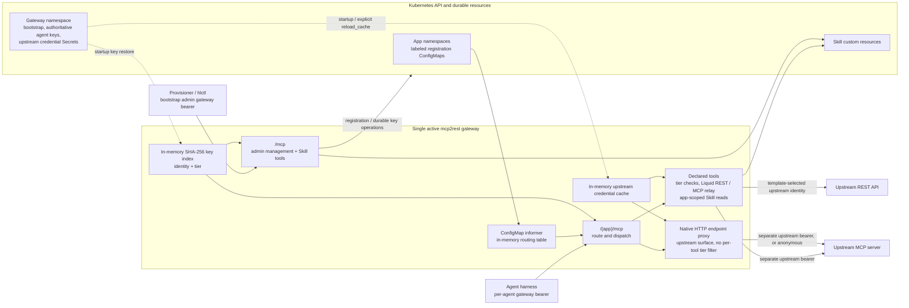
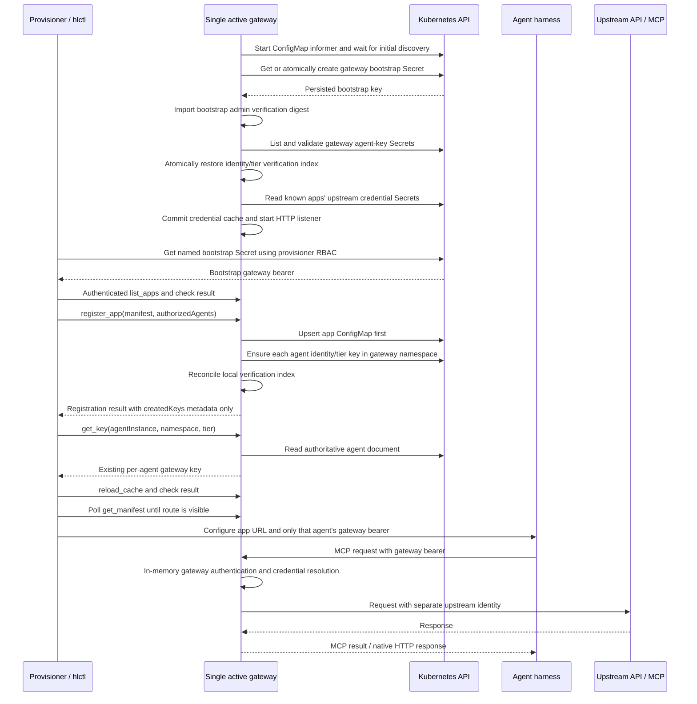

# mcp2rest

A shared, low-overhead Kubernetes proxy that exposes any
[`homelab-catalog`](https://github.com/karlrissland/homelab-catalog) app's
REST API to in-cluster AI agents as standardized
[MCP](https://modelcontextprotocol.io) (Model Context Protocol) tools.

App owners can proxy an existing native MCP endpoint, or supply Liquid
request/response templates plus a manifest to map MCP tools to REST.
Upstream authentication is owned by mcp2rest; agents receive gateway keys,
not the upstream credentials.

## Status

The implemented runtime supports management tools, durable gateway keys,
Liquid REST mappings, per-tool MCP relay, native MCP endpoint passthrough,
Skill tools, and Prometheus metrics. It is not the whole original design.
Code is the system of record; the plan records intent, not shipped guarantees.

- [Runtime and app-author contract](docs/mcp2rest.md): detailed schemas,
  rendering, caller context, tool surfaces, and operational behavior.
- [Configuration and Kubernetes setup](#configuration-and-kubernetes-setup)
- [Bootstrap handoff](#bootstrap-provisioning-credentials) and
  [persistent agent keys](#persistent-agent-keys-and-provisioner-handoff)
- [Management API quick reference](#management-api-quick-reference)
- [Native MCP passthrough](#native-mcp-endpoint-passthrough) and
  [Liquid REST mappings](#liquid-rest-mappings-and-home-assistant-scope)
- [Implementation tracker](tasks.md) and
  [historical architecture/design plan](docs/decisions/mcp2rest-plan.md)

### Recorded integration acceptance

On 2026-10-28, the operator reported that the credential changes worked.
The [gateway implementation issue](https://github.com/karlrissland/homelab-api2mcp/issues/5),
[bootstrap/agent handoff issue](https://github.com/karlrissland/homelab/issues/248),
and [Hermes header-delivery issue](https://github.com/karlrissland/homelab-catalog/issues/156)
were closed as completed. This records that acceptance, not a fresh cluster
test or proof that every app, native Home Assistant rollout, or deferred
capability is implemented.

## Runtime topology



Authentication and upstream credential resolution use memory, not a
Kubernetes lookup per app request. Management mutations and Skill reads/writes
do use Kubernetes. Gateway keys are not upstream tokens. A provisioner owns
agent harness configuration/delivery; mcp2rest owns authoritative gateway
credentials and does not configure harnesses or mint upstream tokens.

## Configuration and Kubernetes setup

| Environment variable | Default | Meaning |
|---|---|---|
| `MCP2REST_ADDR` | `:8080` | HTTP listen address; no built-in TLS listener. |
| `MCP2REST_NAMESPACE` | `mcp2rest` | Storage namespace for bootstrap, agent keys, and upstream credentials; not inferred from the pod namespace. |
| `MCP2REST_SERVICE_NAME` | `mcp2rest` | Service name used to derive `mcpInternalUrl`; does not create a Service. |
| `MCP2REST_DISABLE_AUTH` | unset | Only literal `true` enables the insecure admin-tier bypass. |

The generated internal URL uses HTTP, the configured Service/namespace,
`svc.cluster.local`, and the listen port (fallback `8080`). Ensure your
Service exposes that port; the URL is not probed or discovered.

The entrypoint uses **in-cluster Kubernetes configuration only**: no
kubeconfig fallback, local standalone mode, or configuration flags are
implemented. Deployment wiring must supply a namespace, ServiceAccount,
token/CA/API access, RBAC, network reachability, and a Service (plus
Ingress/TLS if needed). This repository's `manifests` contain RBAC and
observability assets, not a complete Deployment/Service/Ingress bundle or
the Skill CRD definition. Install `skills.skills.homelab.dev` separately
to use Skill tools; the bundled [usage Skill](skills/mcp2rest-usage/SKILL.md)
is documentation, not automatically installed by the executable.

### Minimum permissions by runtime operation

Grant these to the gateway ServiceAccount; Kubernetes permissions are
separate from MCP caller tiers:

| Operation | Kubernetes scope and required verbs | Repository manifest |
|---|---|---|
| Discovery and persisted registration snapshots | ConfigMaps across all namespaces: `list/watch`; registration adds `get/create/update/delete` in each managed app namespace. | [Discovery ClusterRole](manifests/rbac/discovery-clusterrole.yaml) supplies `get/list/watch`, **not** registration writes or a binding. |
| Bootstrap initialization | Named bootstrap Secret: `get`; Secrets in gateway namespace: `create`. | [Bootstrap Role + RoleBinding](manifests/rbac/bootstrap-role.yaml) |
| Durable agent keys | Secrets in gateway namespace: `get/list/create/update`. | [Agent-key Role + RoleBinding](manifests/rbac/agent-keys-role.yaml) |
| Upstream credential preload/reload | Known Secrets in gateway namespace: `get`. | [Upstream Role](manifests/rbac/upstream-creds-role.yaml); add its binding if using it separately. |
| Skill tools | `skills.skills.homelab.dev`: cluster-wide `get/list` for reads; `create/update/delete` in managed namespaces for writes. | [Skills ClusterRole](manifests/rbac/skills-clusterrole.yaml) also grants `watch` (unused by the current Skill API); add bindings. |

The agent-key Role already covers bootstrap and upstream Secret operations;
permissions from separate Roles are additive, not isolation boundaries.
No Secret `watch/delete` or cross-namespace Secret access is required.
Namespace-wide agent-key `list/create/update` cannot be constrained by
label or name prefix using RBAC. Protect the whole gateway namespace:
Secret access can expose credentials, and registration ConfigMap write
access can change executable mappings and upstream destinations.

Startup waits for initial ConfigMap discovery, ensures the bootstrap
Secret, restores all durable agent keys, preloads upstream credentials,
then builds the handlers and starts listening. Discovery can wait
indefinitely if its initial list/watch cannot synchronize. Invalid
registration events are logged/skipped; discovery sync does not prove
every registration was accepted.

There are no `/healthz` or `/readyz` routes. `/metrics` is unauthenticated
and indicates the listener is available, not that upstreams, Skill CRDs,
or every app are usable. The bootstrap Secret may exist even if a later
startup step fails. Deployment readiness must be configured externally;
check authenticated management calls and the intended app separately.

### Bootstrap and agent provisioning sequence

Install prerequisites and provision required upstream Secrets before startup.
The provisioner flow below is an integration contract, not verification
of released hlctl/catalog behavior.



## Bootstrap provisioning credentials

Before accepting HTTP requests, mcp2rest creates or loads an `Opaque`
Secret named `mcp2rest-bootstrap-admin` in `MCP2REST_NAMESPACE` (default
`mcp2rest`). Its `key` data entry contains the gateway bearer credential
for identity `cluster-admin`, tier `admin`. It is a reusable **full-admin**
credential, not a single-use token or registration-only key.

The Secret is the source of truth: an absent Secret is created atomically;
an existing valid key is restored into the in-memory verification store.
Concurrent startups use the creation winner's key, never their unused
candidates. Invalid/missing/empty Secret data, an unexpected Secret type,
or Kubernetes access errors stop startup rather than replacing the key
or starting without authentication. Raw bootstrap keys are never printed.
Initialization is required even with `MCP2REST_DISABLE_AUTH=true`.

### Gateway RBAC and provisioner handoff

Apply [`manifests/rbac/bootstrap-role.yaml`](manifests/rbac/bootstrap-role.yaml)
before deploying this version. It supplies a namespace-scoped Role and
RoleBinding for the default `mcp2rest` ServiceAccount: `get` on the named
bootstrap Secret and `create` on Secrets in the gateway namespace.
Kubernetes cannot constrain `create` by resource name. No bootstrap
list/watch/update/delete or cluster-wide Secret permission is needed.
Render the namespace and ServiceAccount fields for non-default deployments.

The provisioning client should:

1. Deploy the gateway with that RBAC and wait for it to be Ready. The
   Secret alone does not establish readiness if another startup step fails.
2. Read `mcp2rest-bootstrap-admin` using the provisioner's Kubernetes
   credentials. These need `get` on that exact Secret in the gateway
   namespace; they do not need Secret write access for this handoff.
3. Use `Secret.Data["key"]` as the raw bearer value: set the HTTP
   `Authorization` header to the `Bearer` scheme, one space, and that value
   on every management MCP HTTP request,
   including initialization, to `/mcp`. A Kubernetes client's Secret
   data is already decoded; do not base64-decode it again. The default
   in-cluster endpoint is
   `http://mcp2rest.mcp2rest.svc.cluster.local:8080/mcp`.
4. Confirm an authenticated `list_apps` succeeds, then make provisioning
   calls such as `register_app` and `reload_cache`, checking their results.
   Do not scrape pod logs, generate a separate gateway key, or pass this
   full-admin credential to ordinary agent instances. Request their own
   keys through the management API and deliver them as described below.

Retain this Secret across pod restarts and upgrades; the gateway creates
it without a pod/Deployment owner reference. Protect it as a full
gateway-admin credential. The `cluster-admin` identity name does not
confer Kubernetes cluster-admin rights; Kubernetes access uses the
gateway's ServiceAccount permissions.
For controlled bootstrap regeneration, stop **all** gateway replicas,
delete this dedicated Secret using operator credentials, restart the
gateway, and have provisioners reread the new key after readiness.
Existing processes do not watch this Secret; `reload_cache` only reloads
upstream credentials. Per-agent `get_key`/`rotate_key`/`revoke_key` tools
do not manage the bootstrap Secret. Automatic rotation remains deferred.
Agent keys have their own persistent records as described below; neither
bootstrap nor agent-key persistence provides live multi-replica cache
coordination.

When upgrading from the old mint-and-print startup, the provisioner must
switch to reading this Secret instead of reusing a log-delivered key.
Install RBAC first. Before removing any temporary
`MCP2REST_DISABLE_AUTH=true` bypass, verify the handoff is configured.
Then restart without the bypass and confirm authenticated provisioning;
a successful call while bypassed does not prove the credential is valid.

## Management API quick reference

All tools below are on `/mcp` and require a gateway **admin** key at call
time. Local protocol initialization/tool discovery is not itself an
authorization or readiness check. App tools live on separate
`/{app-name}/mcp` connections; management calls do not add them to a harness.
See the [runtime contract](docs/mcp2rest.md) for the full author/API reference.

| Tool | Arguments | Result |
|---|---|---|
| `register_app` | Required `namespace`, `manifest`; optional `configMapName` (default `<manifest.name>-mcp2rest`), `authorizedAgents` entries with `agentInstance`, `namespace`, optional `tier` (default `user`). | `appName`, `namespace`, `configMapName`, `createdKeys` (new key metadata only; no raw keys). |
| `deregister_app` | Required `namespace`, `appName`; optional `configMapName` (default `<appName>-mcp2rest`). | `appName`, `namespace`, `configMapName`, `removed` (`false` if already absent). Keys remain valid. |
| `list_apps` | None. | `{apps: [...]}` from live discovery, including `mcpEndpointPath` and `mcpInternalUrl`. |
| `get_manifest` | Required `appName`. | One discovered manifest with those endpoint fields; error if absent. |
| `create_key` | Required `agentInstance`, `namespace`, `tier`. | `agentInstance`, `namespace`, `tier`, raw `key`; creates an additional credential. |
| `get_key` | Required `agentInstance`, `namespace`, `tier`. | Same fields as `create_key`; retrieves the first persisted matching key, without minting. |
| `list_keys` | None. | `{keys: [...]}` with `agentInstance`, optional `namespace`, `tier`, `createdAt`; includes bootstrap metadata, never raw keys. |
| `rotate_key` | Required `agentInstance`, `namespace`, `tier`. | `agentInstance`, `namespace`, `tier`, raw `key`, `revoked` count. |
| `revoke_key` | Required `namespace`, plus either `rawKey` or both `agentInstance` and `tier`. | `agentInstance`, `namespace`, `revoked` count; no raw key. |
| `reload_cache` | None. | `{apps: N}` for the persisted registration snapshot used to reload upstream credentials; not an agent/bootstrap reload. |

Explicit key tools require `tier` to be `user` or `admin`; there is no
default. Agent names must be Kubernetes DNS subdomain names, and agent
namespaces DNS label names. Registration's agent tier is independent of
the app's declared tool tiers. **Schema caveat:** the explicit
`register_app` input schema currently omits `authorizedAgents[].tier`,
although the handler accepts it.

Registration writes the ConfigMap **before** ensuring agent keys; an
error can leave a registration and earlier keys persisted. It is not a
transaction across agents/resources. Retry with ensure semantics and
inspect results. Registration/deregistration route changes arrive
asynchronously through discovery; neither reloads upstream credentials.
`reload_cache` reads persisted ConfigMaps directly, but does not force the
live routing table to update.

## Persistent agent keys and provisioner handoff

The gateway generates, stores, and validates agent keys. A provisioner
authenticates to management `/mcp` using the bootstrap admin key, requests
an agent key, and delivers **only that agent's key** to its harness.
There is no new token endpoint: the existing management tools are used.

`namespace` identifies the **agent's owning namespace**, not the storage
location. It and `agentInstance` form the stable identity; identically
named agents in different namespaces have distinct keys. `tier` is `user`
or `admin`. The input fields and existing `key` response remain unchanged.
`list_keys` and `register_app.createdKeys` also report the agent namespace.
Repeated `create_key` calls create additional credentials; use `get_key`
for retrieval/reuse, not repeated minting. `register_app.authorizedAgents`
ensures/reuses the requested identity/tier key without rotating it.

Ensure is an internal operation used by `register_app`, not a separate
management tool; `createdKeys` includes only newly minted metadata. Use
`get_key` to retrieve a raw key even after ensure/restart. It errors if
none exists; it does not silently create one. `rotate_key` replaces
**all** keys of the requested identity/tier, preserves other tiers, and
can create a first key with `revoked: 0`. Revoking a raw key requires its
real stored identity to match `namespace` and any supplied
`agentInstance`; the stored tier takes precedence over a supplied `tier`.
Revocation of a missing key/tier returns an error, not success with zero.

These are **gateway-wide tier credentials**, not per-app grants.
`authorizedAgents` ensures keys but does not create an app allowlist;
any valid key can reach any registered app subject to declared tool tiers.
`admin` satisfies `user` and also authorizes all management calls and
Skill writes. The namespace qualifies durable identity, not authorization
scope or an upstream user's identity. Caller username forwarding on the
REST path is separately caller-supplied context, not a verified user
session; see the [runtime contract](docs/mcp2rest.md).

### Authoritative storage and startup

All authoritative agent Secrets live in `MCP2REST_NAMESPACE` (default
`mcp2rest`), never in the agent's namespace. Each has:

- Type `Opaque`, label `mcp2rest.homelab.dev/agent-keys=true`, and no
  pod/Deployment owner reference.
- A deterministic name, `mcp2rest-agent-` plus the first 16 SHA-256 digest
  bytes of `namespace + NUL + agentInstance`, represented as lowercase hex.
- A `keys.json` entry containing a version-1 object with `agentInstance`,
  `namespace`, and `keys`: an array of `{key, tier, createdAt}` records.
  Multiple keys/tiers can coexist for an agent. An empty array records
  that all its keys have been revoked; the Secret is retained.

Before accepting HTTP requests, the gateway validates these Secrets and
atomically restores the verification index, including identity, tier, and
original creation time. The bootstrap key is preserved separately. The
same raw agent key authenticates after restart; re-registering an app or
retrieving the key does not replace it.

Invalid JSON/version/identity/key/tier/timestamp, duplicate credentials,
unexpected Secret ownership/type, or failed startup Secret reads stop
startup without partially loading credentials or printing key material.
Key creation, rotation, and revocation commit to Kubernetes before the
live verification index changes. Failed writes leave the previous
verification state intact and return an error. Kubernetes update
conflicts are surfaced for the caller to retry rather than overwriting
concurrent changes.

Apply [`manifests/rbac/agent-keys-role.yaml`](manifests/rbac/agent-keys-role.yaml)
**before upgrading the gateway**. Render its namespace and ServiceAccount
fields to match the deployment. The gateway needs `get/list/create/update`
on Secrets in its own namespace; no agent-namespace Secret permissions or
delete/watch verbs are needed. Kubernetes RBAC cannot restrict these
dynamic names or startup listing by label. The old cross-namespace
`keys-secrets-clusterrole.yaml` delivery bindings are no longer required
by the new gateway; assess/remove them during the downstream RBAC update.

The provisioner does not need to read these agent Secrets directly: it
uses the admin-authenticated management tools, then installs the returned key as
the harness's bearer credential or writes a delivery Secret in the
agent's namespace. Kubernetes pods cannot directly mount another
namespace's Secret. Delivery copies are not authoritative and do not
grant the gateway access to those namespaces.

### Upgrade and operational limits

Legacy `<agent-instance>-mcp2rest-keys` Secrets containing only a raw
`keys.json` array cannot be safely restored because they lack tier and
creation metadata. They are **not automatically imported or assigned a
default tier**. On the first upgrade, hlctl must issue/ensure keys through
the new gateway and re-deliver them to existing agents; old raw-only
Secrets are not the source of truth. Keys issued through the new storage
remain stable on subsequent restarts.

Use the management API for rotation/revocation. There is no agent Secret
watcher or automatic rotation, and multiple active gateway replicas can
have stale verification caches until separately coordinated. This
change supports restart-safe **single-active-gateway** operation, not
general multi-replica consistency. There is no leader election or
distributed cache invalidation; keeping one gateway active is a deployment
responsibility, including during upgrades. Publication and cluster rollout are
separate steps. Compatibility with external hlctl/catalog delivery and
migration behavior must be verified there; this overview does not assert
that a release or rollout was tested.

## Native MCP endpoint passthrough

A manifest with `upstreamMCPURL` and no declared `tools` proxies the entire
native Streamable HTTP endpoint. For example, submit this payload to the
existing admin-authenticated `register_app` management tool:

```json
{
  "namespace": "homeassistant",
  "manifest": {
    "name": "homeassistant-native",
    "upstreamMCPURL": "http://homeassistant.homeassistant.svc.cluster.local:8123/api/mcp",
    "upstreamCredentialEnv": "HA_TOKEN"
  },
  "authorizedAgents": [
    {"agentInstance": "cluster-agent", "namespace": "agents"}
  ]
}
```

The endpoint is `/{manifest.name}/mcp`. `upstreamMCPURL` must be an
absolute HTTP(S) URL without userinfo or a fragment. Do not put credentials
in URLs. There are no per-tool declarations, schema copies, upstream-tool
discovery caches, or Liquid templates for this path: native `initialize`,
`tools/list`, `tools/call`, errors, content blocks, structured output,
metadata, notifications, and session/streaming headers pass through.
Relist tools or reconnect according to the upstream's MCP behavior when
its available tools change.

Gateway authentication is checked on every forwarded HTTP request.
mcp2rest removes the caller's Authorization and Cookie headers and, when
configured, injects its server-resolved upstream bearer token. Upstream
HTTP statuses and MCP errors remain authoritative. The proxy does not
follow redirects or replay ambiguous POST requests. Origin headers are
preserved; browser clients must satisfy the upstream's origin policy.

Native sessions expose exactly the upstream surface, without gateway
Skill tools or per-tool gateway tier filtering. Existing gateway keys
still authenticate clients; HA permissions/exposure apply to the
configured upstream identity. A shared administrator token does not
preserve individual users' HA permissions. Use the management `/mcp`
endpoint for gateway Skill tools. Native traffic bypasses the local
tool pipeline and its per-tool metrics; upstream transport failures are
logged without credential values.

### Credential provisioning and rotation

1. Provision the upstream bearer credential out of band in
   `<app-instance>-mcp-keys` in mcp2rest's namespace (`MCP2REST_NAMESPACE`,
   default `mcp2rest`). The example uses Secret
   `homeassistant-native-mcp-keys`, data key `HA_TOKEN`.
2. Register the manifest through the existing authenticated management
   interface, then call the admin-only `reload_cache` tool. Reload reads
   persisted registrations, so a newly registered app is included even
   before its ConfigMap informer event arrives.
3. Routing ConfigMaps are applied asynchronously. Wait for `get_manifest`
   to return the registered app before connecting, or retry a transient
   HTTP 404. Connect the agent using its gateway key and the returned
   `mcpInternalUrl`.
   Startup waits for initial registration discovery before loading
   credentials. A native endpoint with a configured but unavailable
   credential returns HTTP 503 rather than sending an anonymous request.
4. To rotate, update the Secret, call `reload_cache`, check its result,
   and reconnect if the upstream requires reauthentication. Subsequent
   HTTP requests use the reloaded credential; already-open streams are
   not restarted. Failed reloads retain the last successful cache and
   report an error. Initial loading fails if a required native credential
   is missing.

Only pre-provisioned bearer tokens and anonymous upstreams are supported
here. Omit `upstreamCredentialEnv` for an anonymous upstream; the gateway
key is still required and is never passed upstream. Long-lived HA tokens
are replaced manually through the Secret/reload flow. OAuth login,
automatic refresh, and token creation are not implemented. Raw upstream
credentials must not enter manifests, templates, skills, agent arguments,
logs, or Helm values/history.

This is the gateway wire contract, not a new app.yaml schema. Existing
manifests that declare tools keep their rendered/per-tool relay behavior.
Compatibility of endpoint-only registration with released hlctl and
catalog provisioning still needs downstream verification; this change
does not modify those repositories or disable gateway authentication.

## Liquid REST mappings and Home Assistant scope

Tools with `type: rendered` execute Liquid
request/response mappings against `upstreamBaseURL`. REST credentials
remain in `<app-instance>-api-keys`; templates reference `credential`
rather than containing a raw token. HTTP 4xx/5xx responses retain mapped
content and set MCP `isError`.
Individually declared `type: passthrough` tools retain their existing
per-tool behavior.

For HA, native passthrough requires its MCP Server integration to be
enabled at `/api/mcp`; the actual upstream tool surface is authoritative.
REST administration can use the existing mapping path. Automation
configuration requires HA to load `automations.yaml`; integration setup
may require hardware interaction or external authentication. No universal
device-creation operation is implied.

Native and REST-mapped surfaces can be registered as separate app instances;
they are not merged into one MCP session. MCP-to-WebSocket mapping,
including HA registry removal and schedule CRUD, is deferred. Do not
claim those operations unless the native upstream itself exposes them.
Deployment-specific HA configuration, tokens, pairing, and device
capabilities require separate validation.

## Repository layout

Runtime wiring lives in `cmd/mcp2rest`; implementations and colocated
tests are in `internal` (`mcpserver`, `adminapi`, `keys`, `discovery`,
`upstreamcreds`, `pipeline`, `render`, `manifest`, `passthrough`,
`skillstools`). Kubernetes clients are currently used directly by the
entrypoint and resource-owning packages; there is no implemented
`internal/k8s` wrapper. See [contributor instructions](.github/copilot-instructions.md)
for conventions and [the runtime contract](docs/mcp2rest.md) for behavior.

## Building and testing

Use the Go version declared in [`go.mod`](go.mod) (currently `1.27.1`).

```sh
go build ./...
go vet ./...
go test ./...
```

The [CI workflow](.github/workflows/ci.yml) additionally runs tests with
`-race -count=1` and golangci-lint. The separate
[release workflow](.github/workflows/release.yml) is configured to build
Linux amd64/arm64 images, push for non-PR events, and build without
pushing for PRs. Defaults are GHCR and the repository image name; repository
variables can override them. Workflow configuration is not evidence that
a particular image was published, tested in a cluster, or rolled out.

## Running locally

`go run` is not a Kubernetes-free development server. Run in a pod with
the prerequisites above, or deliberately supply equivalent in-cluster
ServiceAccount configuration (including `KUBERNETES_SERVICE_HOST`,
`KUBERNETES_SERVICE_PORT`, mounted token/CA, and permissions).
Your normal workstation kubeconfig alone is insufficient; the executable
exits if `rest.InClusterConfig` fails.

From an environment with that setup:

```powershell
go run .\cmd\mcp2rest
```

For ordinary workstation development, prefer unit tests; use a
cluster-hosted gateway and an explicitly configured Service/port-forward
for integration work. The default listener is `:8080`; environment
configuration is listed [above](#configuration-and-kubernetes-setup).

Set `MCP2REST_DISABLE_AUTH=true` to run with authentication/authorization
disabled cluster-wide: every request (per-app, management, and skills
tools) is treated as an authenticated admin-tier caller, regardless of any
key presented. This is a temporary debugging escape hatch only — never
run with this set in production. It does **not** disable Kubernetes
initialization, Secret restoration, upstream credential loading, or the
upstream's own authentication requirements.
