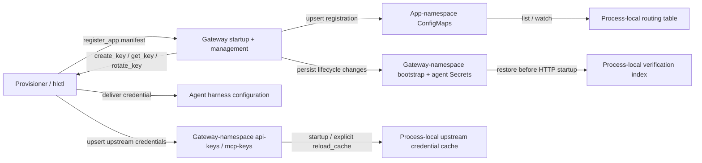

# mcp2rest — REST→MCP Proxy: Feasibility & Architecture Plan

## Implemented baseline (reviewed 2026-10-30)

This decision record preserves the design rationale, not installation
instructions. Use the [README](../../README.md) for setup and the
[runtime contract](../mcp2rest.md) for exact interfaces. Code in this
repository is authoritative; [tasks.md](../../tasks.md) separates local
implementation from unverified downstream rollout.

| Area | Implemented behavior | Superseded proposal / remaining limitation |
|---|---|---|
| Topology | Shared gateway with process-local verification and upstream-credential caches | **Run one active replica.** Persistent Secrets survive restarts, but there is no live cross-replica issuance/revocation/cache coordination; 2+ active replicas are not supported. |
| Bootstrap | Create/load gateway-namespace `mcp2rest-bootstrap-admin`, data entry `key`, before listening; never print it | Mint-and-print and a separate registration-only hlctl key were proposals. hlctl's bootstrap contract uses the **full-admin** credential, not an implemented narrow tier. |
| Agent credentials | Gateway-owned, namespace-qualified records in gateway-namespace `mcp2rest-agent-<identity-hash>` Secrets; versioned `keys.json` includes identity, tier, and creation metadata; restored before serving | Raw-array-only Secrets and gateway writes into agent namespaces are obsolete. hlctl obtains keys via management tools and owns harness delivery. Legacy raw-only keys require reissuance/re-delivery, not inferred authorization metadata. |
| Authorization | Global user/admin tiers; admin also authorizes management and Skill writes | No separate per-app grant store or distinct control-plane admin scope. `authorizedAgents` ensures identity/tier keys; it is not a per-app ACL. |
| App routes | Declared rendered/per-tool passthrough tools **or** a transparent native MCP endpoint (§3.5) | No combined local/native inventory. Native routes do not inject Skill tools or enforce mapped-tool tiers. |
| Upstream credentials | Provisioner-owned `<app>-api-keys` / `<app>-mcp-keys` in gateway namespace; read-only preload and manual `reload_cache` | No registration payload credential values or Secret watcher. Native configured credentials fail closed; legacy mapped tools retain empty-string fallback (§3.8). |
| Future stages | Named Go pipeline and observability exist | Governance/policy enforcement, WASM loader/ABI, automatic rotation, per-user upstream credentials, and full per-tool ACLs remain deferred. |

Startup waits for discovery sync, validates/restores bootstrap and agent
credentials, then loads upstream credentials before binding HTTP
(`cmd/mcp2rest/main.go`). Invalid persisted agent/bootstrap state or a
failed initial credential reload prevents startup. Persistence does not
make live out-of-band Secret edits immediately effective.

### Historical rollout snapshot (2026-10-01; not current verification)

Earlier reports described `homelab#216` platform provisioning as
substantially done, `homelab#215` schema/validation as partly done with
registration pending, `homelab#217` credential provisioning as pending,
and `homelab-catalog#103` MeTube work as blocked. Those reports and later
live-debugging notes in `tasks.md` are historical evidence only. This
repository cannot establish today's hlctl/catalog code, issue status,
cluster deployment, or CI health. In particular, the old report that a
restart loses all keys is superseded by persistent bootstrap/agent
Secrets; the old assertion that end-to-end use is impossible is not a
current rollout conclusion.

The later [2026-10-28 integration acceptance](../../README.md#recorded-integration-acceptance)
records operator-confirmed credential changes and completed gateway,
provisioner, and Hermes issues. It does not turn the original plan's
remaining proposals into shipped capabilities or establish Home
Assistant-specific acceptance.

## Guiding Principles (north star for every design choice below)

The original plan was designed iteratively; dated refinements below
retain that reasoning trail. Every
choice should keep optimizing for:

- **Simple** — fewest moving parts/protocols/identities that solve the
  problem today (e.g. one MCP surface instead of MCP + a separate admin
  REST API).
- **Fast, low resource** — a shared, low-footprint pod; avoid anything
  that adds idle cost or a heavyweight runtime.
- **Grows with the project** — the pipeline/tool-definition shape must
  leave room for governance/security stages, per-tool scoping, key
  rotation, etc. later, without a rewrite. We are deliberately deferring
  those, not designing them away.

Implemented corrections are marked explicitly where the original
proposal differs from the runtime.

## 1. Problem & Goal

Agent-over-HTTP capability varies wildly across harnesses; MCP usage is
stable. Goal: a standardized, low-overhead way to expose any homelab-catalog
app's REST API to in-cluster agents as proper MCP tools, so agent
integration is uniform regardless of harness. The app/service owner supplies
Liquid templates (request + response) plus a small manifest describing the
MCP surface; a shared proxy pod renders/executes them at request time. The
pipeline shape must allow AI governance/security stages to be added later
without re-architecting.

## 2. Feasibility Assessment: **HIGH — no architectural blockers**

Strong existing precedent in `homelab` / `homelab-catalog` de-risks most of
this:

The following is the **original feasibility assessment**, including
references to those repositories at design time, not a fresh audit of
their current implementation. Its "net-new"/"today" statements describe
the pre-implementation baseline.

- **Liquid-as-integration-contract is already proven**: `providermap`
  (`internal/providermap/providermap.go`) renders per-app Liquid templates
  against a deterministic context and injects the result into Helm values —
  same idea, one-shot render instead of per-request.
- **A generalized "hlctl provisions a dedicated MCP server, apps register
  into it" hook already exists**: `clusteragent.EnsureMCPServer` deploys
  `kubernetes-mcp-server` per Cluster-Agent instance; the
  `provisionMcpServer` app.yaml hook already patches Hermes'
  `config.yaml` with `{type: streamable-http, url: ...}` entries
  (`hooks/provision-mcp-server.py`). mcp2rest slots into this exact
  registration contract.
- **The exact gap is already documented and reasoned about**:
  `docs/decisions/mcp-server-and-cluster-agent.md` §2.8/§2.8a/§5 — today,
  "apps with an API" are discovered via a `Skill` CRD labeled
  `skills.homelab.dev/topic=api`, documented as raw curl examples, and
  accessed with **full admin-level credentials** handed to the agent
  (explicitly flagged there as deferred hardening work, §5). mcp2rest is the
  natural next increment: real MCP tool schemas instead of curl-in-docs, and
  narrower, per-agent scoped keys instead of admin credentials.
- **Cross-namespace, label-selector discovery of app-owned K8s objects is
  already a working pattern**: `internal/skillscrd` + its
  `hlctl-skill-reader` ClusterRole. mcp2rest's proxy-side discovery reuses
  the same shape.
- **Credential injection without ever touching Helm/cluster.yaml is already
  solved**: `internal/credentials` + `internal/aicreds` (secret staging,
  per-app Secret upsert, env-var-by-reference).

**What is genuinely net-new** (the real effort, not just wiring):
1. A **runtime, per-request, bidirectional Liquid transform engine**
   (request in → REST call → response out) — `providermap` only proves
   one-shot render; nothing today executes Liquid per inbound MCP call.
2. A **shared, multi-tenant MCP proxy** with per-app-instance routing,
   K8s-native config discovery (push + watch/informer), and **per-agent
   API-key issuance/authorization** — none of this exists yet anywhere in
   the stack.
3. **Cross-repo wiring**: a new admin API contract between `hlctl`
   (`homelab`) and the new proxy (`homelab-api2mcp`), plus a new
   `homelab-catalog` authoring convention (`mcpTools:` + `maps/mcp/**`).

None of this is blocked by anything structural — it is genuinely buildable
with the existing conventions — but it is a **three-repo effort**
(`homelab-api2mcp`, `homelab`, `homelab-catalog`) with real integration
surface, not a weekend project.

## 3. Confirmed Decisions

- **Topology**: one shared, multi-tenant gateway (not one pod per app)
  behind a ClusterIP Service. The original 2+ replica target is deferred:
  use one active replica until verification-cache coordination exists.
- **External routing**: single host, path-routed per app instance —
  `https://mcp2rest.<dns.zone>/<app-instance>/mcp`.
- **Transport**: MCP Streamable HTTP (matches `kubernetes-mcp-server` and
  Hermes' existing `type: streamable-http` registration).
- **Tech stack**: **Go**. All three languages (Go/Rust/C#) have Tier-1
  official MCP SDKs with Streamable HTTP support and comparable per-request
  overhead for a proxy workload — the deciding factor is ecosystem fit, not
  raw throughput: `hlctl` and `kubernetes-mcp-server` are already Go, the
  team already depends on `github.com/osteele/liquid` in Go, and a second
  toolchain (Rust/C#) buys negligible real-world benefit here while adding a
  second build/release pipeline to maintain. Single static binary,
  distroless image, low idle footprint — matches the "low overhead pod"
  goal directly.
- **Governance pipeline**: build the request path now as an **ordered,
  named middleware chain** (authn → authz → tool-resolve →
  render-request → upstream-call → render-response → respond), with any
  future governance/security stage insertable without re-architecting.
  Authn/authz, tool resolution, rendering, upstream execution and response
  handling are functional; logging/metrics are observability, not policy.
  Real governance/security-policy stages remain unimplemented.
- **Tool definition shape** (your design, adopted): for each REST operation
  an app wants exposed, the app author supplies a **`request.liquid`** and
  a **`response.liquid`**, plus one **manifest (YAML/JSON)** per app
  describing the MCP surface — what the MCP server is, which
  APIs/operations/tools it exposes, and each tool's parameters
  (JSON-schema-shaped). All of this (manifest + templates) is delivered as
  **one ConfigMap scoped to the app's own namespace** — Kubernetes is the
  durable state store; no separate database.
- **Registration flow (implemented contract)**: `register_app` accepts a
  manifest and owning namespace, validates it and upserts the discovery
  ConfigMap. It ensures gateway-owned keys for supplied
  `authorizedAgents` using each declared tier (default `user`). hlctl
  retrieves keys through management tools and delivers them to harnesses.
  The earlier "gateway delivers directly; hlctl never handles raw keys"
  proposal is superseded. ConfigMap visibility follows informer events,
  not a synchronous routing-table mutation.
- **Self-healing discovery (original recommendation, now implemented)**: in
  addition to the push-on-deploy path, the proxy also **lists/watches**
  ConfigMaps by a label (e.g. `mcp2rest.homelab.dev/app=<name>`) cluster-wide
  on its own startup and on change — this is the same
  list/watch-by-label-selector shape `internal/skillscrd` already uses, and
  it means a proxy restart (or a missed push because the proxy was
  temporarily down during some other app's deploy) **self-heals** from the
  ConfigMaps already sitting in etcd, instead of requiring an operator to
  re-run `hlctl app setup` for every app. The ConfigMap remains the single
  source of truth either way; the admin-API push is purely the synchronous
  fast path for validation and key assurance. The response includes
  newly created key metadata, not raw credentials; use `get_key` for
  delivery. A registration call is not a multi-resource transaction.
- **Upstream auth**: the original registration-call value transfer was
  replaced by provisioner-written gateway-namespace Secrets (§3.8).
  Manifest `upstreamCredentialEnv` names a Secret data key, not a runtime
  process environment lookup.
- **Config-declaration location**: new `mcpTools:` block in `app.yaml`,
  schema-owned by `hlctl` (same ownership convention as `providerMap`).
- **Key/scope ownership (revised after persistence)**: dropped the earlier
  `hlctl mcp2rest key create|list|revoke` CLI idea. mcp2rest owns key
  lifecycle — minting, gateway-namespace storage, manual rotation and
  revocation. hlctl owns provisioner-side key retrieval/harness delivery;
  `allowedApis` was a proposal, not an implemented authorization field.

### 3.1 Refinement (this session, 2026-09-27): single MCP surface, no separate admin API

Talking it through further, two more decisions:

- **No bespoke admin REST API at all.** mcp2rest exposes exactly **one**
  interface — MCP (Streamable HTTP). The original two tool categories
  below were later joined by Skill tools (§3.4):
  1. **Per-app proxied tools** — the regular case, one tool set per
     registered app instance, filtered by the caller's key tier.
  2. **A reserved management tool set** on mcp2rest itself
     (`register_app`, `deregister_app`, `list_apps`, `create_key`,
     `list_keys`, `revoke_key`, `rotate_key`, `get_manifest`, …), gated by
     **admin** tier. Ongoing key lifecycle management can be done by
     *talking to an agent* that holds admin tier — not a new hlctl
     CLI, not a second bespoke API. This is the "leverage our agents for
     this instead of building another API" call.
  - `hlctl`'s integration contract uses MCP for registration, key retrieval
    and credential-cache reload, authenticated with the persisted
    **full-admin** bootstrap key. The earlier single-call/narrow-key
    proposal is superseded. The original proposal favored a small typed
    JSON-RPC helper rather than a full SDK for deploy-time calls.
    Streamable HTTP also has session/header semantics; transparent
    native endpoints may use streaming GET/DELETE as well as POST.
    The downstream client implementation is owned by `homelab`.
  - This unifies the protocol surface (one auth model, one transport, one
    schema style) instead of running a REST admin API alongside the MCP
    server.

### 3.2 Per-tool admin/user tiers (added 2026-09-30)

An app can surface more than one MCP tool, and each tool can be annotated
in its manifest as `tier: user` or `tier: admin` (e.g. Gitea's
`list_my_repos` vs. `admin_create_user`). Resolved model (kept simple per
the Guiding Principles): **a key is issued as `user` or `admin` for a
namespace-qualified agent**; `admin` implies `user`. A call to an `admin`-tier tool with a
`user`-tier key is rejected at the authz pipeline stage. Full per-tool
allow-lists (beyond this two-tier split) remain deferred future work —
the original proposal distinguished control-plane admin scope from
per-app admin tier, but the implementation does **not**: an admin-tier
key also authorizes management tools and Skill writes. User keys are not
restricted to the app that caused their creation.

### 3.3 Multi-user / per-caller identity scoping — e.g. Penpot (added 2026-09-30)

Some apps' REST APIs are themselves multi-user (Penpot, etc.) — an
agent acting "on behalf of" one end user must only touch that user's
records. Resolved for v1:

- **Keys are minted per agent *instance*, not per agent role/app.** This
  is a real, needed departure from the existing `aicreds.SecretName`
  precedent (keyed only by app name, shared across every Hermes user
  instance at design time) — Penpot-style scoping is meaningless without knowing
  *which* end user a given call is for. Concretely: one Hermes user's
  Helm-release instance gets its own mcp2rest key(s), not a key shared
  across every Hermes instance in the `hermes` namespace.
- **Storage identity includes agent namespace and instance**, not just
  app/role: `keys.AgentSecretName` hashes that identity into
  `mcp2rest-agent-<identity-hash>` in the gateway namespace. The original
  `<agent-instance>-mcp2rest-keys` agent-namespace Secret was a delivery
  proposal, not today's authoritative store. hlctl owns delivery copies.
- **v1 upstream-scoping mechanism: header/param impersonation only.** The
  render context for `request.liquid` gains a `caller` object
  (`{agentInstance, username, tier, appInstance}`). For apps whose shared
  admin-level credential already supports scoping a call to one end user
  via a header/query param/path segment (the pattern Penpot's own API, or
  Plex's managed-user model, would need to support), the template uses
  `caller.username` to build that. **No new per-(app,user) credential
  storage in v1** — that (storing a distinct upstream token per end user,
  for apps that require it instead of supporting impersonation) is an
  explicit future candidate (not numbered delivery Phase 2), deferred because it's meaningfully more
  work than reusing the existing per-app credential store.
- `caller.username` is a client-supplied reserved argument
  (`__mcp2rest_caller_username`), stripped before Liquid receives `args`.
  It is an impersonation hint, not an independently verified user identity.
- **Practical v1 consequence**: apps that require true per-user tokens
  (no shared-admin-plus-impersonation option) are simply **not yet
  supportable as multi-user mcp2rest tools** until that deferred feature lands. This is
  an explicit, accepted v1 gap, not a silent one.

### 3.4 Built-in "skills" tool namespace (added 2026-09-30)

In addition to per-app proxied tools and the management tool set,
mcp2rest ships a built-in tool namespace wrapping the `Skill` CRD system
through `internal/skillstools` (the referenced `internal/skillscrd` belongs
to `homelab`, not this repo):

- On `/mcp`, `list_skills` / `get_skill` remain cluster-wide and available
  to **any** authenticated key, not just admins. On locally defined app
  routes, `list_<slug>_skills` / `get_<slug>_skill` return that app's
  labeled Skills plus unlabeled/global Skills (Phase 25). Transparent
  native routes inject no Skill tools. The original everywhere-unfiltered
  proposal was revised; management reads remain deliberately broad.
- `create_skill`, `update_skill`, `delete_skill` — write, **admin-scope
  only**, on `/mcp`. This is the same implemented admin tier used by
  mapped tools, not a separate control-plane credential class.
- **Direction of travel: replaces the Cluster Agent's direct K8s RBAC
  read access to Skill CRDs** (original intent) — at design time the
  Cluster Agent read `Skill` CRDs via its own `hlctl-skill-reader`
  ClusterRole; the proposed future read path would move behind this
  mcp2rest tool too, for every agent including the Cluster Agent. Note:
  actually retiring the Cluster Agent's existing direct RBAC is a
  `homelab`-side follow-up, not something this plan changes by itself —
  called out here so it isn't lost.
- mcp2rest therefore also needs its own read (and, for admin calls,
  write) RBAC to `Skill` CRDs cluster-wide — essentially inheriting
  `hlctl-skill-reader`'s scope itself, plus a write grant for the admin
  path.

### 3.5 Passthrough mode — apps with their own MCP server (added 2026-09-30)

There are now two distinct modes; the original per-tool relay design
must not be mistaken for transparent native forwarding.

| Manifest shape | Request behavior | Inventory and authorization |
|---|---|---|
| Explicit `tools`, including `type: passthrough`, `upstreamToolName`, and effective `upstreamMCPURL` | Local MCP SDK dispatch through the named pipeline; relay invokes the selected upstream tool, without Liquid execution | Declared tool list with local user/admin filtering, plus app-scoped Skill reads. Rendered and per-tool relay definitions can coexist. |
| No tools plus app-level `upstreamMCPURL` (`IsNativeMCP`) | Authenticate gateway bearer key, then reverse-proxy the HTTP endpoint, including streaming/session traffic, without interpreting MCP bodies | Upstream owns discovery, schemas, tools/resources/prompts and their policy. No synthetic tools, Skill injection, combined inventories or local per-tool tier enforcement. |

Use the exact JSON field `upstreamMCPURL`, not the original prose spelling
`upstreamMcpUrl`. Native forwarding strips gateway Authorization and
cookies; only a server-resolved upstream bearer credential may be
injected. If a native endpoint configures `upstreamCredentialEnv`, a
missing credential rejects forwarding rather than silently calling the
upstream anonymously. See `internal/manifest/manifest.go`,
`internal/mcpserver/runtime.go` and `internal/passthrough/proxy.go`.

### 3.6 Plugin extensibility — reserved, not built in v1 (added 2026-09-30)

Even though no 3rd-party plugin support ships in v1, the pipeline design
must not preclude it later. Resolved direction: **WASM-loadable pipeline
stages**, using a pure-Go WASM runtime (e.g. `wazero`) rather than Go's
native `plugin` package (which is fragile, platform/version-locked, and
effectively Go-only for plugin authors). This keeps mcp2rest itself a
single static Go binary while allowing a future governance/security
vendor (or anyone) to ship a sandboxed stage in whatever language compiles
to WASM, hot-loaded into the same ordered pipeline (§3 Confirmed
Decisions' `authn → authz → tool-resolve → render → call → render →
respond` chain) as an additional named stage. No implementation in v1 —
this only constrains the pipeline's internal stage interface to be
"WASM-loadable-shaped" from the start so it isn't a rewrite later.
This is architectural intent only: the current Go `Stage` abstraction is
not a shipped WASM ABI, sandbox, loader, or hot-loading implementation.

### 3.7 Meta-Skill: teaching agents how to use mcp2rest itself (added 2026-09-30, RESOLVED 2026-09-30)

Separate from §3.4's built-in *skills* tool (which exposes *other apps'*
Skills), agents also need to know how mcp2rest itself works: how to
discover which app-instance paths/tools they're authorized for, how the
user/admin tier split behaves, and how errors from the pipeline surface.
**Resolved — keep it simple**: no new platform-skill directory
convention needed. `homelab-api2mcp` ships its own `Skill` CRD source
content (a `SKILL.md`-shaped file) alongside its own deployment manifests,
and the downstream provisioning contract is that this Skill is applied
to the cluster like any other — discoverable via `list_skills`/
`get_skill` (§3.4) exactly the same way an app's own Skills are. mcp2rest
dogfoods its own built-in skills tool for its own documentation; no
separate mechanism required. The source exists here; actual downstream
application and post-bootstrap visibility are not verified by this repo.

### 3.8 Per-tool upstream credential injection (RESOLVED — homelab-api2mcp#1)

`App.UpstreamCredentialEnv`/`UpstreamMCPURL` existed from the start but
were never actually consumed anywhere — no credential storage or
injection existed at any granularity, and real apps need per-tool
granularity (e.g. a read-only token for a "list" tool vs. an admin token
for a "delete" tool). This was raised as `homelab-api2mcp#1` and resolved
through a dedicated design conversation. Final design:

- **Per-tool override, app-level fallback.** `Tool` gains optional
  `UpstreamCredentialEnv`/`UpstreamMCPURL` fields; `Tool.
  EffectiveCredentialEnv(App)`/`EffectiveUpstreamMCPURL(App)` return the
  tool-level value when set, else the app-level value. An empty result
  means "no credential required" — no special-casing needed downstream.
- **Secret shape**: **native multi-key `Secret.data`** (not a JSON blob)
  in two distinct Secrets per app
  instance, distinct from gateway-owned `mcp2rest-agent-<identity-hash>`
  agent-key Secrets:
  - `<app-instance>-api-keys` — credentials for rendered/REST tools.
  - `<app-instance>-mcp-keys` — credentials for passthrough tools.
  Both live in **mcp2rest's own namespace**, not the app's namespace.
- **Who writes the Secret**: `hlctl`, directly into mcp2rest's namespace
  (not passed through `register_app`). mcp2rest only ever *reads*
  these Secrets — this is a `get`-only RBAC grant
  (`manifests/rbac/upstream-creds-role.yaml`), smaller and namespace-
  scoped, distinct from `agent-keys-role.yaml` for persistent agent keys.
  The old cross-namespace delivery ClusterRole is a legacy artifact, not
  a requirement of the current credential repository.
  Secret lifecycle on `deregister_app` is explicitly left to `hlctl` to
  manage — mcp2rest does no deregister-time cleanup of its own.
- **Full in-memory preload, manual reload only** (`internal/
  upstreamcreds.Cache`) — chosen over live per-call Secret reads (avoids
  per-call latency) and over a K8s watch/informer (unnecessary
  complexity for how rarely credentials rotate). `Reload(ctx, apps)`
  rebuilds the whole cache from the supplied app list every call,
  so deregistered/renamed apps' stale entries are dropped on the next
  successful reload, not automatically on informer events.
  Exposed as one admin-tier MCP tool, **`reload_cache`** — no scoping
  parameters in v1.
  Startup reloads after discovery sync; `reload_cache` takes a fresh
  persisted ConfigMap snapshot so it need not wait for informer events.
  Registration and Secret edits do not reload credentials implicitly.
  Read errors or missing configured native credentials fail the reload
  atomically, retaining the previous snapshot; an initial failure
  prevents startup.
- **Upstream-cache reads need only `get`, never `list`/`watch`**, on Secrets —
  app names are known from discovery or its persisted snapshot, so the
  cache resolves exactly which two Secret names to fetch per app without
  needing a label convention or broader read access.
- **Credential binding is a single resolved string, not the full
  credential map** — each tool's Liquid render context sees exactly the
  one value for its own `EffectiveCredentialEnv` key, via a new
  `{{ credential }}` Liquid binding (`internal/render.Context.Credential`),
  mirroring exactly how `caller.*` was wired in Phase 8. Multi-value
  upstream credentials (e.g. OAuth id+secret pairs) are an accepted v1
  limitation — combine into one string and parse in the template if
  needed.
- **Legacy mapped-tool fallback on missing credentials**: an unprovisioned or missing
  credential resolves to `""`, passed straight through to the backend
  call. The backend's own auth rejection is the error signal, surfaced to
  the caller as a normal tool-call error — no special "credential
  missing" branch in this mapped-tool path. This is **not** the native
  endpoint policy: a configured native credential is required on reload
  and forwarding; missing/invalid values do not fall back to anonymous
  forwarding. Kubernetes API access errors are reload errors in both modes.
- **Passthrough auth convention (new gap, discovered during this design
  pass)**: `internal/passthrough/relay.go` had *no* auth-injection
  mechanism at all. Resolved: a fixed bearer-scheme Authorization
  header, injected via a wrapping `http.RoundTripper` on the relay's
  `http.Client` (the Go MCP SDK's `StreamableClientTransport` has no
  native `Headers` field). No per-app configurable auth scheme in v1.

### 3.9 `get_key` admin tool — delivery rationale and later persistence revision

**Historical motivation (2026-10-02):** the first implementation used
raw arrays and resolved tiers using the live in-memory store. The
following config-templating constraint explains why `get_key` was added;
that raw-array implementation is no longer the storage contract.

`homelab-api2mcp#2` flagged that `keys.json` (the per-instance key Secret,
§3.3/Open Decision 6) stores raw keys as a flat `[]string` with no
tier/app metadata, leaving array position as the only (undocumented)
signal for "which entry is the current user-tier key." Investigating the
actual driver (`homelab#220`, wiring mcp2rest auth into OpenClaw's MCP
registration) surfaced a real conflict with this plan's repeated "hlctl
never receives or stores any per-agent key" principle (§3.1, §5.2, Open
Decisions 3/5): OpenClaw's own MCP client config format
(`mcp.servers.<name>.headers` in `openclaw.json`, written by
`provision-mcp-server.sh`) has **no indirect secret-reference
mechanism** — it requires a literal header value baked in in-place at
deploy time. Apps whose MCP client config is templated this way (the
same pattern Hermes already uses for `provisionMcpServer`) genuinely
cannot "mount the Secret and read it themselves" the way an agent's own
long-running container can.

**Resolved at the time**: mcp2rest gained an admin-scoped management tool:
**`get_key(agentInstance,
namespace, tier) → rawKey`**. hlctl (already an MCP client for
`register_app`) calls this with its own bootstrap key when it needs a
literal credential value for a config-templated hook like OpenClaw's.

**Current implementation:** hlctl-owned delivery is the general
contract, not just a config-templating exception. `get_key` resolves the
namespace-qualified identity/tier from the gateway's persisted,
versioned `keys.json` document and reconciles the local verification
index (`keys.AgentKeys.Get`). `create_key` and `rotate_key` also return
raw material to their admin caller; listing returns metadata only.
Legacy raw-only Secrets cannot safely recover authorization metadata and
require reissuance/re-delivery. Do not copy their array positions into a
new document or grant inferred tiers. This replaces the earlier
"no format migration needed" conclusion while preserving its original
reason for avoiding arbitrary agent-namespace Secret reads.

## 4. Decision history — resolutions and implementation corrections

Flagging these explicitly rather than assuming, matching this org's own
"resolve before implementation, don't re-litigate per PR" convention
(`docs/decisions/mcp-server-and-cluster-agent.md` §2.8a):

1. ~~Which agents get keys for which apps.~~ — **RESOLVED 2026-09-30:
   auto-grant.** Deploying an app with an `mcpTools` manifest is itself
   the opt-in — every agent instance automatically receives a
   `user`-tier key for every app registered with mcp2rest, no separate
   `cluster.yaml` allow-list needed. `admin`-tier keys still require an
   **explicit grant** (not auto-granted to anything) — see Open
   Decision 5 for who/how that's requested. No new `cluster.yaml` schema
   needed for this. **Implementation boundary:** the gateway only ensures
   keys for the supplied `authorizedAgents`; it does not enumerate every
   agent or maintain per-app grants. Each supplied tier defaults to
   `user` but may explicitly be `admin`. Downstream selection of agents
   is not verified here.
2. ~~Scope granularity in v1~~ — **RESOLVED 2026-09-30**, see §3.2: a
   key is issued as `user` or `admin` per namespace-qualified agent
   (`admin` implies `user`). The original per-app grant distinction was
   not implemented; full custom per-tool ACLs remain deferred.
3. ~~Where does the proxy itself deploy from?~~ — **RESOLVED 2026-09-30**:
   `homelab-api2mcp` is containerized and published as a **public GHCR
   image** built by its own repo's CI/CD — the exact same distribution
   pattern `homelab-hub` already uses (`ghcr.io/karlrissland/homelab-hub`,
   `src/hub/app.yaml`'s `image.repository`/`image.tag` fields). `hlctl`
   pulls that image to deploy it, the same way it deploys Hub. The one
   difference from Hub: **mcp2rest is included by default as part of the
   platform**, not a `homelab-catalog` app a user opts into installing —
   it's provisioned automatically alongside the other platform/core
   services (Traefik, Prometheus, Grafana), with exactly one cluster-wide
   instance, no per-user choice to make. (Mechanically this still means
   `hlctl` needs a small new "pull this GHCR image + deploy its
   Deployment/Service/Ingress/RBAC" provisioning step, mirroring
   `EnsureMCPServer`'s own shape, rather than going through the
   `custom-helm` catalog-app install path Hub uses — since mcp2rest has no
   per-user Helm values to configure.) This records the downstream
   provisioning intent, not verified current `homelab` behavior.
4. ~~Key rotation/revocation lifecycle.~~ — **RESOLVED 2026-09-30**:
   manual-only for v1 — issue-once + manual revoke via mcp2rest's own
   `revoke_key` MCP tool (talk to an admin-scoped agent). Automatic
   rotation is explicitly **documented as a future feature**, not built,
   matching this org's own precedent of shipping permissive-but-working
   first and hardening once real usage is known (§5 of the same decision
   doc).
5. ~~Who holds the "admin" scope for mcp2rest's management tools?~~ —
   **Original resolution (2026-09-30), superseded in mechanism:** keep
   bootstrap privileged material out of automatic agent delivery; the
   mint-and-print suggestion borrowed kubeadm's one-time-token model,
   with a separate narrow hlctl credential proposed for registration.
   **Implemented:** create/load `mcp2rest-bootstrap-admin` in the gateway
   namespace and restore it before listening; never print it. hlctl
   retrieves this **full-admin** key using Kubernetes credentials.
   There is no registration-only tier or separate management admin
   scope. Explicit admin-tier agent keys also authorize management, so
   the original "human only" restriction is not enforced by a distinct
   identity class. The bootstrap key itself is not automatically
   delivered to agents. Use README's retrieval/regeneration contract,
   not the historical print-on-install proposal.
6. **Secret-write privilege scope — revised after persistence.**
   The initial design traded least privilege for simpler cross-namespace
   delivery, proposing a broad Secret-writing ClusterRole. The claimed
   namespace-label restriction was not a capability of Kubernetes RBAC:
   labels cannot constrain a ClusterRoleBinding's namespace scope.
   Namespaced RoleBindings can bind a ClusterRole within individual
   namespaces, but no label-filtered Secret permission exists.
   **Implemented:** gateway-owned agent records use the gateway namespace
   only (`agent-keys-role.yaml`: get/list/create/update); bootstrap uses
   `bootstrap-role.yaml`; upstream credentials use get-only
   `upstream-creds-role.yaml`. The gateway no longer needs Secret writes
   into agent namespaces. The remaining
   `keys-secrets-clusterrole.yaml` is a legacy direct-delivery artifact,
   not current setup guidance; hlctl owns any delivery-side RBAC.
7. ~~Where does the mcp2rest usage Skill live?~~ — **RESOLVED
   2026-09-30**, see §3.7: `homelab-api2mcp` ships its own Skill CRD
   source alongside its deployment manifests; it's applied at deploy time
   like any other Skill and read back via mcp2rest's own `list_skills`/
   `get_skill` tools — no new platform-skill directory convention needed.
8. ~~Privilege note on `all-skills-any-key`~~ — **confirmed 2026-09-30,
   revised in Phase 25.** Any authenticated key can still read any Skill
   cluster-wide through `/mcp`; mapped app routes now expose only their
   own plus global Skills, and native routes inject none (§3.4).
   The original breadth-over-least-privilege choice acknowledged that
   some Skills, e.g. an app's `security`/`authentication` topic, may contain
   more operational detail than a narrowly-scoped per-user agent strictly
   needs. Real usage later motivated app-session filtering; that
   filtering is not an app ACL or an admin-only management read policy.
9. ~~Per-tool upstream credential storage/injection (homelab-api2mcp#1).~~
   — **RESOLVED, implemented**, see §3.8 for the full design: two Secrets
   per app instance (native multi-key `Secret.data` —
   `<app-instance>-api-keys`/`<app-instance>-mcp-keys` — written directly
   by `hlctl` into mcp2rest's namespace), `get`-only RBAC, full in-memory
   preload with a manual `reload_cache` admin tool, a single resolved
   `{{ credential }}` Liquid binding per mapped tool call, and empty
   string fallback for missing mapped-tool credentials. Native endpoints
   require any explicitly configured upstream credential.

## 5. Architecture

### 5.1 `homelab-api2mcp` (this repo) — the mcp2rest proxy binary

- Go; official MCP Go SDK (Streamable HTTP transport);
  `github.com/osteele/liquid` (same library `hlctl` already depends on, for
  consistent templating semantics across the platform).
- **Single MCP (Streamable HTTP) surface — no separate admin REST API.**
  Management and Skill tools on `/mcp`; app-specific tools on
  `/{app-instance}/mcp`, not one combined inventory:
  - **Per-app proxied tools** — the regular case, one tool set per
    registered app instance, Bearer-key authenticated and tier-checked
    (§3.2); there is no per-key app allow-list. Manifests may declare a
    tool as `type: passthrough`
    (§3.5) to relay directly to an app's own MCP server instead of
    rendering Liquid templates.
  - **Built-in `skills` tools** (§3.4) — management reads (any valid
    key), management writes (admin tier), app-scoped reads on locally
    defined app routes only.
  - **Reserved management tools** on mcp2rest itself (`register_app`,
    `deregister_app`, `list_apps`, `create_key`, `list_keys`, `revoke_key`,
    `rotate_key`, `get_key`, `reload_cache`, `get_manifest`), gated by
    **admin** tier. mcp2rest persists namespace-qualified agent records
    in its own namespace; hlctl retrieves and delivers credentials.
  - A manifest with no tools and `upstreamMCPURL` instead selects
    **transparent native HTTP forwarding**, bypassing the local SDK
    inventory, Skill injection and mapped-tool pipeline (§3.5).
- **Keys are minted per agent *instance*** (§3.3), not per role/app — the
  render context passed to `request.liquid` includes a `caller` object
  (`{agentInstance, username, tier, appInstance}`) so multi-user apps
  (Penpot, etc.) can scope the upstream call via header/param
  impersonation in v1.
- **Routing table**: in-memory, keyed by app-instance → tool set; built
  from a K8s informer over ConfigMaps labeled
  `mcp2rest.homelab.dev/app=<name>` (list on startup, watch for updates),
  and updated by informer events after registration upserts its ConfigMap.
  Routing names are global, not namespace-qualified.
- **Request pipeline** (ordered, named stages, each independently
  swappable/insertable later, with **future WASM extensibility intended** so a
  future stage can be a sandboxed 3rd-party plugin without a rewrite,
  §3.6): `authn → authz(tier) → tool-resolve → render(request.liquid)
  → upstream HTTP call (with injected credential) → render(response.liquid)
  → respond`. v1 governance-adjacent stages (logging/metrics) are
  pass-through observability only. Passthrough-mode tools skip the two
  Liquid executions and relay the selected tool call. Native endpoints use the
  separate HTTP proxy, not this pipeline.
- Structured stdout logging + `/metrics` (Prometheus) — fits the existing
  observability convention (every workload's logs/metrics are scraped the
  same way, per §2.10 of the decision doc).
- Distroless image and single static binary. The original resource target
  borrowed `kubernetes-mcp-server`'s `25m`/`64Mi` baseline; workload
  resource settings are downstream, not supplied by this repo.
- This repo ships **RBAC and observability manifests**, not a
  Deployment/Service/Ingress bundle. Downstream provisioning owns those
  resources and should run **one active replica**. Supplied RBAC covers
  read-only ConfigMap discovery, Skill reads/writes, and gateway-
  namespace credential access. Registration additionally needs ConfigMap
  create/update/delete permissions provisioned downstream; those writes
  are not granted by `discovery-clusterrole.yaml`.
  Discovery's label selector is application
  filtering, not an RBAC-enforced label restriction (Open Decision 6).

### Implemented state ownership

Persistence and informer discovery are distinct: neither agent-key
Secrets nor upstream-credential Secrets have a live cache watch. The
diagram is an ownership contract, not evidence that downstream rollout
has completed.

### 5.2 `homelab` (`hlctl`) changes

**Downstream integration contract, not verified implementation status.**
Package names below preserve the original proposal; see `tasks.md` for
historical issue references and the runtime contract for current payloads.

- New `app.yaml` schema block `mcpTools:` (path to a manifest describing
  tools/tiers/passthrough-vs-rendered + `maps/mcp/**/request.liquid` /
  `response.liquid` per rendered tool, analogous to `providerMap.template`).
- New package `internal/mcpproxy` (mirrors `internal/providermap`):
  render + validate the manifest/templates at `app validate` time so
  authoring mistakes fail fast, before any deploy.
- Deploy-time wiring (mirrors `cluster_agent_reconcile.go`'s
  `EnsureMCPServer` call): after a successful app install, build/update the
  registration payload, then call mcp2rest's `register_app` MCP tool for
  the app, supplying an `authorizedAgents` array via a typed
  JSON-RPC helper authenticated with the persistent full-admin bootstrap
  key. The original intent was automatic user-tier provisioning for all
  agent instances (Open Decision 1); the gateway only processes supplied
  entries, not an `allowedApis` allow-list. mcp2rest upserts the
  ConfigMap and ensures keys; hlctl obtains raw keys through management
  tools and owns harness configuration/agent-namespace delivery.
  Upstream Secrets must be provisioned separately, followed by
  `reload_cache` after registration or credential changes.
- No new `cluster.yaml` block needed for per-app grants — Open Decision 1
  resolved to auto-grant `user`-tier keys to every agent instance.
- No new `hlctl mcp2rest key` CLI — dropped in favor of mcp2rest's own
  management MCP tools, driven by the human cluster admin's own agent/tool
  session using their bootstrap admin-scope key (Open Decision 5).
- New docs: `docs/mcp2rest.md` (user-facing contract, mirrors
  `docs/ai-providers.md`) and a
  `docs/decisions/mcp2rest.md` capture doc (this org's own convention).

### 5.3 `homelab-catalog` changes

**Historical rollout proposal, not a current catalog audit.**

- Apps opt in with `mcpTools:` + `maps/mcp/**` in their own directory —
  same authoring shape as `providerMap`/`maps/*.liquid` today.
- **Pilot app: MeTube** (revised 2026-09-30, was originally Gitea — switched
  because MeTube needs far fewer cluster resources to stand up and iterate
  against, which matters more than endpoint richness for a pilot whose goal
  is proving the pipeline itself). It already has a mature `metube-api`
  Skill enumerating exactly the endpoints worth exposing, and — unlike
  Gitea — has no API-level auth at all, so the pilot can skip credential
  wiring entirely and focus purely on the render/discovery/pipeline
  mechanics. That research is directly reusable as the first real
  `mcpTools` manifest, and validates the whole pipeline end-to-end on one
  real app before wider rollout (mirrors this org's own "thin vertical
  slice first" phasing principle).

## 6. Relationship to the existing "api" Skill / Cluster Agent credential flow

- Does **not** replace the `Skill` CRD `api` topic — it remains useful
  human/agent-readable documentation and a fallback for any endpoint not
  yet wrapped as an MCP tool.
- **Does** replace raw curl-with-admin-credential access for any endpoint
  wrapped as a mapped MCP tool: schemas and tool tiers can narrow the
  exposed operations, and gateway keys avoid handing an agent the app's full
  admin-level credential. This directly addresses the "app credential
  scope-down" hardening item this org already flagged as future work
  (§2.8/§5 of the existing decision doc). This does not imply per-app
  gateway key ACLs, independently verified end-user identity, or local
  per-tool enforcement on transparent native endpoints.
- `EnsureMCPServer`/`kubernetes-mcp-server` (the Cluster Agent's own
  K8s-introspection MCP server) is unaffected and separate — that is
  cluster-control-plane access; mcp2rest is app-REST-API access.

## 7. Phased delivery plan (small, independently testable phases)

Each phase below is scoped to be independently buildable, independently
testable, and independently mergeable — no phase requires "big bang"
integration with a later phase to prove itself. Phases are numbered in
dependency order; a phase's "Depends on" lists strict prerequisites. This
replaces the earlier coarse Phase 1-5 grouping with something granular
enough to track in `tasks.md`.

These are delivery goals, **not completion claims or setup steps**.
`tasks.md` records partial/deferred acceptance and subsequent phases
16–25 plus persistence/native-endpoint follow-ups. For example, a local
fake-client test is not evidence that a cluster pilot, platform
provisioning or live scrape has completed.

- **Phase 0 — Repo scaffolding.**
  - *Goal*: `homelab-api2mcp` exists as a buildable, lintable, CI-checked
    Go module, with nothing functional yet.
  - *Deliverables*: `go.mod`, directory layout (§ Copilot instructions'
    layout section), `.github/workflows/ci.yml` (build + vet + lint +
    test), `.github/copilot-instructions.md`, root `README.md`, `LICENSE`.
  - *Test/acceptance*: CI passes on an empty/skeleton `main.go` that just
    prints a version string and exits 0.
  - *Depends on*: nothing.

- **Phase 1 — MCP server skeleton, no transform yet.**
  - *Goal*: a real MCP Streamable HTTP server boots, answers
    `initialize`/`tools/list`/`tools/call` for exactly one hardcoded
    "echo" tool (no Liquid, no REST upstream, no auth).
  - *Deliverables*: `internal/mcpserver` package wrapping the official Go
    MCP SDK; `cmd/mcp2rest/main.go`.
  - *Test/acceptance*: an MCP client (or raw JSON-RPC via `curl`) can call
    the echo tool and get back a deterministic response; unit test covers
    the JSON-RPC envelope.
  - *Depends on*: Phase 0.

- **Phase 2 — Static single-app Liquid transform.**
  - *Goal*: prove the genuinely-new piece — a real inbound MCP tool call
    is rendered through `request.liquid`, executed as a real HTTP call
    against one real upstream (Gitea, using a manually-supplied token via
    env var for this phase only), and the HTTP response is rendered back
    through `response.liquid` into the MCP tool result.
  - *Deliverables*: `internal/render` (Liquid render context + execute),
    one hardcoded manifest + template pair checked into a `testdata/`-style
    fixture (not yet ConfigMap-sourced).
  - *Test/acceptance*: an integration test (or documented manual test
    against a real/dev Gitea instance) exercises one full request→render→
    call→render→respond round trip end-to-end.
  - *Depends on*: Phase 1.

- **Phase 3 — Two-tier (`user`/`admin`) authz.**
  - *Goal*: add the authn (static API key, hardcoded for this phase) and
    authz (tier check) pipeline stages in front of Phase 2's tool call.
  - *Deliverables*: `internal/pipeline` with named, ordered stages
    (`authn → authz → tool-resolve → render → call → render → respond`);
    a `user`-tier key and an `admin`-tier key, both hardcoded for now.
  - *Test/acceptance*: unit tests prove a `user`-tier key is rejected on
    an `admin`-tier-tagged tool, and accepted on a `user`-tier tool; an
    invalid/missing key is rejected before any upstream call is made.
  - *Depends on*: Phase 2.

- **Phase 4 — ConfigMap-based manifest discovery.**
  - *Goal*: replace Phase 2's hardcoded fixture with a real Kubernetes
    informer that lists/watches ConfigMaps labeled
    `mcp2rest.homelab.dev/app=<name>` and builds the in-memory routing
    table from them.
  - *Deliverables*: `internal/discovery` (informer + routing table);
    RBAC manifests for cluster-wide ConfigMap list/watch.
  - *Test/acceptance*: an envtest/kind-based integration test creates a
    ConfigMap with a manifest+templates, confirms the tool becomes
    callable within one reconcile cycle, then deletes it and confirms the
    tool disappears.
  - *Depends on*: Phase 3.

- **Phase 5 — Key issuance + per-instance Secret delivery.**
  - *Goal*: replace Phase 3's hardcoded keys with real per-agent-instance
    key minting and durable namespace-qualified records in gateway-owned
    Secrets. Original direct-to-agent delivery is superseded; hlctl owns
    harness delivery.
  - *Deliverables*: `internal/keys` repository, own-namespace
    `agent-keys-role.yaml`, startup restoration.
  - *Test/acceptance*: fake-client tests cover restart, namespace/tier
    identity, lifecycle changes, invalid data and failed writes; keys
    authenticate against the runtime. No cross-namespace writer grant
    is required by this repository.
  - *Depends on*: Phase 4.

- **Phase 6 — Management tool set + human-admin bootstrap.**
  - *Goal*: implement `register_app`, `deregister_app`, `list_apps`,
    `create_key`, `list_keys`, `revoke_key`, `rotate_key`, `get_manifest`
    as real MCP tools, gated by an admin-scope key, including the
    persisted bootstrap key described in the update above.
  - *Deliverables*: `internal/adminapi` (tool handlers), `internal/keys`
    bootstrap Secret create/load and verification restoration at startup.
  - *Test/acceptance*: integration test registers a real app via
    `register_app` and confirms Phase 4's discovery path picks it up
    without a pod restart; confirms a non-admin key cannot call any
    management tool.
  - *Depends on*: Phase 5.

- **Phase 7 — Built-in `skills` tool namespace.**
  - *Goal*: `list_skills`/`get_skill` (any authenticated key) and
    `create_skill`/`update_skill`/`delete_skill` (admin scope only),
    wrapping the existing `Skill` CRD.
  - *Deliverables*: `internal/skillstools`; RBAC for `Skill` CRD
    read (cluster-wide) and write (admin path).
  - *Test/acceptance*: integration test creates a `Skill` CRD directly via
    kubectl/client-go, confirms `list_skills`/`get_skill` see it; confirms
    `create_skill` via a `user`-tier key is rejected, via the admin key
    succeeds and is visible back via `get_skill`.
  - *Depends on*: Phase 6.

- **Phase 8 — Multi-user impersonation (`caller` context).**
  - *Goal*: add the `caller` object (`{agentInstance, username, tier,
    appInstance}`) to the Liquid render context so a manifest's
    `request.liquid` can scope an upstream call to one end user.
  - *Deliverables*: `internal/render` context extension; one pilot
    manifest exercising it (recommend Penpot once available, or a mock
    multi-user upstream if Penpot isn't ready yet).
  - *Test/acceptance*: integration test proves two different `caller`
    identities calling the same tool produce two different rendered
    upstream requests (e.g. different `X-Impersonate-User` header values).
  - *Depends on*: Phase 5 (needs per-instance keys to know "which caller").

- **Phase 9 — Passthrough mode.**
  - *Goal*: a manifest declaring `type: passthrough` +`upstreamMcpUrl`
    relays JSON-RPC directly to an upstream MCP server, skipping render
    stages, with tier-tagging of individual upstream tool names.
  - *Deliverables*: `internal/passthrough` (relay client + tool-name
    filter).
  - *Test/acceptance*: integration test against a real or stub upstream
    MCP server proves a `user`-tier key sees only non-admin-tagged tools
    in `tools/list`, and an `admin`-tagged tool call from a `user`-tier
    key is rejected before the relay happens.
  - *Depends on*: Phase 6 (reuses the same auth/routing pipeline).

- **Phase 10 — `hlctl` integration.**
  - *Tracked upstream*: [homelab#215](https://github.com/karlrissland/homelab/issues/215)
    — per cross-repo policy, this repo does not implement `homelab`-side
    work directly; it was requested via a GitHub issue for that team.
  - *Goal*: `homelab`'s `hlctl` gains the `mcpTools:` app.yaml schema
    block, `internal/mcpproxy` (render/validate at `app validate` time),
    and the minimal MCP/JSON-RPC client that calls `register_app`/
    `deregister_app` plus key retrieval and `reload_cache` at deploy time
    using the persisted **full-admin** bootstrap key. The originally
    proposed narrow registration credential does not exist.
  - *Deliverables*: schema change, `internal/mcpproxy`, deploy-step wiring
    (mirrors `EnsureMCPServer`'s call shape).
  - *Test/acceptance*: `hlctl app validate` fails fast on a malformed
    `mcpTools` manifest (bad Liquid syntax, schema violation); a real
    `hlctl app setup` against a dev cluster results in the app visible via
    mcp2rest's `list_apps`.
  - *Depends on*: Phase 6.

- **Phase 11 — mcp2rest platform-service provisioning in `hlctl`.**
  - *Tracked upstream*: [homelab#216](https://github.com/karlrissland/homelab/issues/216).
  - *Goal*: `hlctl` provisions mcp2rest itself — pulling its public GHCR
    image and deploying it by default as part of the platform bootstrap
    (Open Decision 3), the same way it provisions Traefik/Prometheus.
  - *Deliverables*: a new `internal/mcp2rest` (or similarly named)
    provisioning package in `homelab`, mirroring `EnsureMCPServer`'s
    Deployment/Service/Ingress/RBAC shape.
  - *Test/acceptance*: a fresh cluster bootstrap results in mcp2rest
    running and reachable at `mcp2rest.<dns.zone>` with no explicit
    per-app install step.
  - *Depends on*: Phase 6 (needs a real image/binary to provision).

- **Phase 12 — Catalog pilot: MeTube end-to-end.**
  - *Tracked upstream*: [homelab-catalog#103](https://github.com/karlrissland/homelab-catalog/issues/103).
  - *Goal*: validate the whole pipeline on one real `homelab-catalog` app.
  - *Deliverables*: `mcpTools:` manifest + `maps/mcp/**` templates for
    MeTube (switched from Gitea 2026-09-30 — far lower resource footprint
    to iterate against, and no API auth to wire up for the pilot),
    reusing the research already captured in its `metube-api` Skill.
  - *Test/acceptance*: a real agent (Hermes or the Cluster Agent) calls a
    real MeTube-backed MCP tool end-to-end through the deployed cluster.
  - *Depends on*: Phase 10, Phase 11.

- **Phase 13 — mcp2rest's own usage Skill.**
  - *Goal*: ship the "how to use mcp2rest" Skill (§3.7) bundled with
    mcp2rest's own deployment, applied as a `Skill` CRD at deploy time.
  - *Deliverables*: `SKILL.md` content in `homelab-api2mcp`, applied by
    Phase 11's provisioning step.
  - *Test/acceptance*: after a platform bootstrap, `list_skills`/
    `get_skill` (Phase 7) returns mcp2rest's own usage Skill without any
    extra step.
  - *Depends on*: Phase 7, Phase 11.

- **Phase 14 — Observability.**
  - *Goal*: structured logs + `/metrics` (Prometheus), Grafana
    dashboard/alerts for the shared proxy.
  - *Deliverables*: metrics middleware stage in the pipeline; Grafana
    dashboard JSON + alert rules (mirrors other apps'
    `monitoring.alerts` convention).
  - *Test/acceptance*: Prometheus scrapes mcp2rest successfully; a
    dashboard panel shows non-zero request counts after Phase 12's pilot
    traffic.
  - *Depends on*: Phase 6.

- **Phase 15 — Deferred / explicitly out of scope for v1 (stub only).**
  - Real governance/security pipeline stages (PII redaction, rate
    limiting, policy engine).
  - The WASM plugin loader itself (§3.6 only reserves the pipeline
    stage's shape as WASM-loadable from Phase 3 onward; it does not build
    the `wazero` loader).
  - Automatic key rotation (Open Decision 4 — manual only in v1).
  - Per-(app, user) credential storage for multi-user apps that can't use
    impersonation (§3.3, deferred future work).
  - Full per-tool ACLs beyond the two-tier user/admin split (§3.2
    deferred future work).

## 8. Explicit non-goals / still deferred

- The original planning pass made no code changes; implementation has
  since shipped in this repo. This document refresh is documentation only.
- No automatic key rotation (Open Decision 4 resolved manual-only).
- No full per-tool ACLs beyond the two-tier user/admin split (§3.2 —
  future candidate, not numbered delivery Phase 2).
- No per-(app,user) credential storage for multi-user apps (§3.3 — future
  candidate); apps requiring true per-user tokens are out of scope until
  then.
- No real governance/policy logic or WASM plugin loader/ABI (Phase 15).
- No live multi-replica key/cache coordination or distinct registration-
  only bootstrap credential.
- No retiring of the Cluster Agent's existing direct `Skill` CRD RBAC
  (§3.4's "replaces" direction is recorded intent, not executed here).

## 9. Supporting artifacts (historical planning inventory, 2026-09-30)

Alongside this plan, three supporting artifacts were drafted for review:

The session-workspace paths below are provenance, not current setup
locations. The committed tracker is now [tasks.md](../../tasks.md),
contributor instructions are `.github/copilot-instructions.md`, and
the required authoring skills are under `.github/skills/`.

- **`tasks.md`** (session workspace `files/tasks.md`) — a per-phase task
  checklist mirroring §7, with a status column. This is the working
  tracker once implementation starts; update it instead of re-deriving
  status from this plan.
- **`copilot-instructions-draft.md`** (session workspace
  `files/copilot-instructions-draft.md`) — draft `.github/copilot-
  instructions.md` for the new repo: priorities (correctness >
  readability > code reuse > low overhead), the repo's package layout
  (`cmd/`, `internal/{mcpserver,pipeline,render,discovery,keys,adminapi,
  skillstools,passthrough,k8s}`, `manifests/`, `skills/`, `docs/`), and
  pointers to the two skills below. Not yet placed in the actual repo —
  pending your review and plan approval (repo files aren't mutated while
  still in plan mode).
- **Two new skills** (session workspace `files/skills/`), synthesized
  from public references since no existing skill in `homelab`/
  `homelab-catalog` covers generic Go/Docker practice (only
  repo-specific ones like `go-cli-architecture` exist):
  - `go-best-practices/SKILL.md` — Go idioms/readability/code-reuse
    conventions, adapted from Effective Go, the Google Go Style Guide,
    and the Uber Go Style Guide.
  - `docker-container-best-practices/SKILL.md` — multi-stage builds,
    distroless/minimal images, non-root, no-baked-secrets, adapted from
    Docker's own published best practices.

The draft/review wording above describes the original planning session;
it does not mean these committed artifacts are still awaiting placement.
