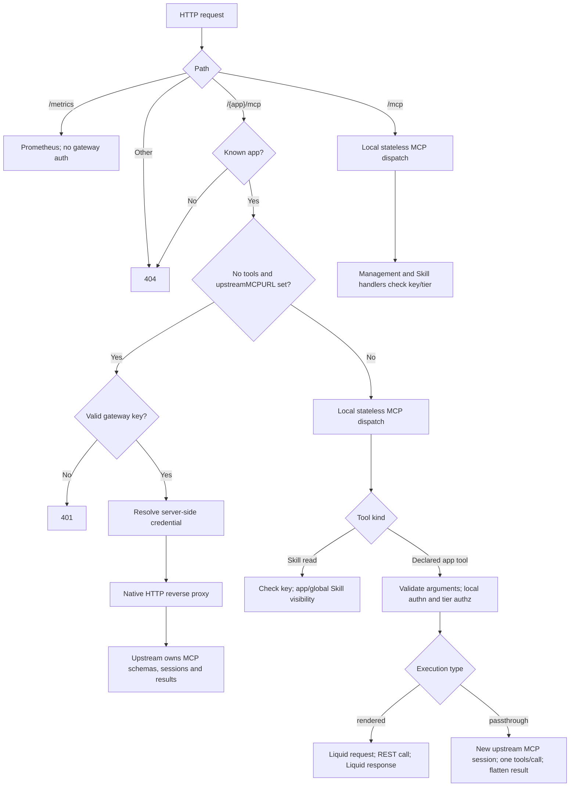
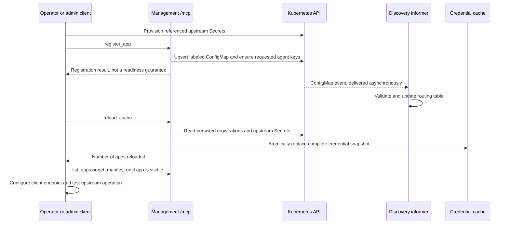

# mcp2rest: client and app contract

mcp2rest exposes Kubernetes-registered apps through MCP over HTTP. An app can
publish Liquid-backed REST tools, explicitly mapped upstream MCP tools, or an
entire native MCP endpoint. These are **different execution paths**, not
interchangeable ways to preserve an upstream MCP server.

This document describes the current implementation, primarily
[`runtime.go`](../internal/mcpserver/runtime.go),
[`manifest.go`](../internal/manifest/manifest.go), and
[`discovery.go`](../internal/discovery/discovery.go). Historical design documents
are background, not the wire contract. See the [README](../README.md) for running
the gateway and for durable bootstrap, agent-key storage, recovery, delivery,
rotation, and revocation operations.

## Choose the right endpoint

| HTTP path | Purpose | Authentication boundary |
| --- | --- | --- |
| `/mcp` | Management tools and cluster-wide Skill tools; never app tools | Tool handlers require an admin key for management/Skill writes; Skill reads accept user or admin |
| `/{app}/mcp`, with declared `tools` | Only that app's mapped REST/MCP tools, plus app-scoped Skill reads | Each app call runs local authentication and per-tool tier authorization |
| `/{app}/mcp`, without tools but with `upstreamMCPURL` | Transparent HTTP proxy to the native MCP endpoint | A valid user or admin gateway key is required **before any request is forwarded**; upstream handles its own MCP permissions |
| `/metrics` | Prometheus metrics, including Go/process collectors | No gateway key check |

Other paths, unknown apps, nested app paths, and trailing-slash variants such as
`/mcp/` return HTTP 404. There is no local health endpoint or all-apps combined
tool endpoint. A *combined app* is one manifest whose `tools` mix `rendered` and
`passthrough`; it still lives at that one app's `/{app}/mcp`.



### Connect a client

Use an MCP **Streamable HTTP** client with
`Authorization: Bearer <gateway-agent-key>` on requests. The gateway key
identifies an agent instance and its `user` or `admin` tier; it is not the app's
upstream credential.

An admin can call `list_apps` or `get_manifest` on `/mcp` to discover registered
app configuration. Their returned manifests include:

- `mcpEndpointPath`: `/{name}/mcp`;
- `mcpInternalUrl`: the full in-cluster URL, when the gateway's internal base
  URL is configured. The shipped entrypoint derives it from service name,
  gateway namespace, and listen port, for example
  `http://mcp2rest.mcp2rest.svc.cluster.local:8080/example/mcp`.

Prefer the internal URL for in-cluster clients. External HTTPS requires a
separately configured ingress/DNS/TLS setup. Neither management call adds a
server to a client, returns an agent key, or makes app tools callable on `/mcp`.
Configure a separate client server entry for each required app endpoint.

### Keys, tiers, and what is actually protected

- `user` can call declared user-tier tools; `admin` can call both tiers.
- Keys have **no per-app grants**. A valid key can reach any registered app,
  subject to local tool tiers where applicable.
- `authorizedAgents` in registration ensures keys exist. It is not an app ACL.
  Deregistering an app does not revoke those keys.
- On locally dispatched routes, initialization and tool discovery are not
  wrapped in an HTTP authentication gate. Unauthorized app tools are removed
  from `tools/list`, but a direct call by name is still checked by the pipeline.
  Management and built-in Skill tool names remain advertised even when their
  handlers will deny the caller.
- On native routes, every HTTP request is authenticated before proxying.
  There is no local per-tool tier filtering or authorization; user/admin both
  pass this gateway boundary. Do not select native mode expecting the gateway
  to restrict individual upstream tools.
- `MCP2REST_DISABLE_AUTH=true` deliberately treats every caller as admin,
  including callers with no key. This affects management, Skills, mapped tools,
  and the native gateway check; it does not disable upstream authentication.
  It is a debugging escape hatch, not a production configuration.

The [key operations in the README](../README.md) describe how keys are
provisioned and persisted. Do not put raw keys or upstream secrets in manifests,
templates, or Skill content.

## Three app execution modes

### 1. Native endpoint-only HTTP passthrough

Register a manifest with **no tools** (omitted or empty) and a nonempty
`upstreamMCPURL`. That combination alone selects native mode:

```json
{
  "namespace": "apps",
  "manifest": {
    "name": "native-example",
    "upstreamMCPURL": "http://native-example.apps.svc.cluster.local:8080/mcp",
    "upstreamCredentialEnv": "token"
  }
}
```

This is the `arguments` object for an admin `register_app` call on `/mcp`.
The example assumes that service exists and its `token` credential has been
provisioned as described below; registration does not create either.

The [native proxy](../internal/passthrough/proxy.go):

- forwards HTTP methods and bodies without decoding JSON-RPC or reconstructing
  tools, input/output schemas, annotations, instructions, or result envelopes;
- preserves native MCP content, `structuredContent`, metadata, and `isError`;
  upstream sessions, notifications, and streaming remain upstream protocol
  behavior rather than gateway-generated features;
- replaces the path with the configured upstream path; combines configured
  query parameters with the incoming query parameters;
- removes the incoming `Authorization` and `Cookie`, then supplies
  `Authorization: Bearer <resolved-upstream-value>` if configured;
- uses normal HTTP reverse-proxy header handling, immediately flushes streamed
  responses, and propagates request cancellation;
- does not follow upstream redirects or implement application-level retries.
  It returns upstream redirects to the client.

There are **no gateway Skill tools**, local argument validation, local tool
pipeline, or local per-tool metrics on this path. Use `/mcp` for gateway Skills
and management. A configured but unavailable/invalid upstream bearer credential
produces HTTP 503; an upstream transport failure produces HTTP 502. An anonymous
upstream is supported by omitting `upstreamCredentialEnv`: the gateway key is
still required and is never substituted as the upstream credential.

### 2. Declared per-tool MCP relay

A declared tool with `type: passthrough` is a **local tool mapping**, not the
transparent native path. It requires `upstreamToolName` and an app- or
tool-level `upstreamMCPURL`, and uses the local input schema (or its empty-object
default). The local name may differ from the upstream name.

The [relay](../internal/passthrough/relay.go) opens a new upstream MCP client
session for each call, invokes one `tools/call`, and closes it. It does not
discover or merge upstream tool lists/schemas. The local pipeline validates
arguments, authenticates the gateway key, checks the declared tier, removes the
reserved caller argument, and passes the remaining arguments upstream. A
resolved credential is sent as a fixed Bearer header.

Results become **one local text content block**:

- text blocks are joined with newlines;
- non-text blocks become their JSON representation in that text;
- only when upstream `content` is empty is `structuredContent` serialized as
  the text fallback.

The upstream result envelope is not preserved: in particular, upstream
`isError`, metadata, and structured content alongside nonempty content do not
survive as corresponding local fields. Connection/call/close failures do become
local tool errors. Select native mode when fidelity to the upstream MCP surface
matters.

### 3. Liquid REST mappings, including combined apps

A declared tool with `type: rendered` renders an HTTP request, calls REST, then
renders text from the response. A single app may mix these with declared
passthrough tools; the presence of **any** tools selects local dispatch, even
when the app also has `upstreamMCPURL`.

This complete discovery ConfigMap demonstrates a combined app. The example
service URLs and credential keys must be provisioned for your deployment.

```yaml
apiVersion: v1
kind: ConfigMap
metadata:
  name: example-mcp2rest
  namespace: apps
  labels:
    mcp2rest.homelab.dev/app: example
data:
  manifest.yaml: |
    name: example
    upstreamBaseURL: http://example.apps.svc.cluster.local:8080
    upstreamMCPURL: http://example-native.apps.svc.cluster.local:8080/mcp
    upstreamCredentialEnv: token
    tools:
      - name: get_item
        description: Read one item from the REST API.
        tier: user
        type: rendered
        inputSchema:
          type: object
          properties:
            id:
              type: integer
              minimum: 1
            __mcp2rest_caller_username:
              type: string
          required: [id]
          additionalProperties: false
        requestTemplate: |
          {"method":"GET","path":"/api/items/{{ args.id }}","headers":{"Authorization":"Bearer {{ credential }}"}}
        responseTemplate: "{{ response.rawBody }}"
      - name: search_native
        description: Search through a declared upstream MCP tool.
        tier: admin
        type: passthrough
        upstreamToolName: search
        upstreamCredentialEnv: search-token
        inputSchema:
          type: object
          properties:
            query:
              type: string
          required: [query]
          additionalProperties: false
```

Here `get_item` reads `token` from `example-api-keys`, whereas `search_native`
reads `search-token` from `example-mcp-keys`, both in the **gateway namespace**.
Neither declaration references a template file: the template fields contain
literal Liquid source.

## Registration and manifest reference

### Management registration

`register_app` arguments are:

| Field | Contract |
| --- | --- |
| `namespace` | Required namespace in which the discovery ConfigMap is persisted |
| `configMapName` | Optional; defaults to `<manifest.name>-mcp2rest` |
| `manifest` | Required app object described below |
| `authorizedAgents` | Optional array of `{agentInstance, namespace, tier?}`; the namespace identifies the agent owner, not upstream credential storage |

`authorizedAgents[].tier` accepts `user` or `admin` and defaults to `user`,
independently of app tool tiers. **Schema caveat:** the explicit input schema
currently advertises only `agentInstance` and `namespace` for these entries,
although the handler accepts `tier`. Schema-driven clients may not expose it.
Registration returns `{appName, namespace, configMapName, createdKeys}`.
`createdKeys` contains newly created identity metadata, not raw credentials;
already-existing keys are not repeated.

The operation validates the manifest and upserts the ConfigMap **before**
ensuring agent keys. It is not transactional: a later key failure can leave the
registration (and earlier ensured keys) persisted.

### App and tool fields

Field names below are the JSON/camelCase manifest names, also accepted inside
the ConfigMap's YAML.

| App field | Meaning |
| --- | --- |
| `name` | Required, globally unique routing-table name, not namespace-qualified; use a Kubernetes-label-safe single URL segment |
| `namespace` | Set from the source ConfigMap namespace, not trusted as registration ownership input |
| `tools` | Declared local tools; absent/empty plus `upstreamMCPURL` means native mode |
| `upstreamBaseURL` | Base for relative REST request `url`/`path`; unnecessary for absolute rendered URLs |
| `upstreamMCPURL` | Native endpoint URL or default endpoint for declared passthrough tools |
| `upstreamCredentialEnv` | Default **Secret data key**, despite the historical `Env` suffix; not an environment-variable lookup |
| `mcpEndpointPath`, `mcpInternalUrl` | Derived management response fields; do not supply them as configuration |

| Tool field | Meaning |
| --- | --- |
| `name` | Required, unique within this app; exposed unchanged to clients |
| `description` | Human-facing description |
| `tier` | Required: `user` or `admin`; there is no implicit default for a tool |
| `type` | Required: `rendered` or `passthrough` |
| `inputSchema` | JSON Schema object; omitted/empty becomes `{"type":"object"}`, and a missing top-level `type` is filled with `object` |
| `requestTemplate`, `responseTemplate` | Both nonempty for `rendered` |
| `upstreamToolName` | Nonempty for `passthrough` |
| `upstreamMCPURL` | Optional per-tool override of the app's MCP URL |
| `upstreamCredentialEnv` | Optional nonempty per-tool override of the app's credential key |

An empty override falls back to the app value; it does not disable that value.
Avoid names colliding with built-in Skill tools: there is no manifest
collision check for that namespace.

Validation checks required names, duplicate local tool names, recognized
tiers/types, required templates/upstream tool names, and the presence of an
effective URL for declared passthrough tools. Native URLs must be absolute
HTTP(S), with a hostname and no userinfo or fragment.

Registration does **not** precompile Liquid or input schemas, probe upstream
connectivity, or verify credentials. Declared per-tool URLs and rendered
request destinations do not receive the native endpoint's URL checks.
`upstreamBaseURL` is a resolver base, not an outbound-host allowlist: a rendered
absolute URL can select another destination. Treat manifests as trusted
admin-controlled configuration.

### Discovery and readiness

The gateway watches ConfigMaps across all namespaces carrying
`mcp2rest.homelab.dev/app=<app-name>`. The value must be nonempty and match
`manifest.name`. It chooses the first nonempty entry in this order:
`manifest.yaml`, `manifest.yml`, `manifest.json`; otherwise exactly one data
entry is accepted as YAML. JSON decoding is selected specifically for the
`manifest.json` source name. Unknown fields are not a strict typo check.

Discovery updates routing asynchronously. App names must be globally unique:
the live table skips a conflicting second source rather than creating a
namespace-qualified route. An invalid update removes that source's existing
route; it does not keep the last valid manifest. Deletion also removes the route.



Registration does not automatically reload credentials or wait for discovery.
`reload_cache` reads persisted ConfigMaps directly, so it can load a newly
registered app's credentials before its informer event arrives. It does not
force routing-table readiness. Wait for `list_apps`/`get_manifest` to show the
expected registration, then verify the app endpoint. Neither visibility nor
reload success proves upstream connectivity.

## Liquid request and response contract

The [renderer](../internal/render/renderer.go) uses the upstream Liquid engine
without gateway-specific filters. JSON/URL/header escaping is the template
author's responsibility; interpolating arbitrary strings directly into JSON
is unsafe. The numeric identifier example above avoids that particular issue.

### Request template

Request bindings are:

| Binding | Value |
| --- | --- |
| `args` | Validated tool arguments, excluding the reserved caller username field |
| `caller.agentInstance` | Agent instance from the authenticated gateway key |
| `caller.tier` | Authenticated key tier |
| `caller.appInstance` | Target manifest's app name |
| `caller.username` | Optional per-call username supplied by the agent, or empty string |
| `credential` | Resolved upstream Secret value, or empty string |

An agent may include `__mcp2rest_caller_username` in tool arguments. If present,
it must be a nonempty string after trimming. The runtime removes it from `args`
and declared relay arguments. It is **agent-asserted**, not proof of an
authenticated human user. No upstream impersonation header is automatic:
templates must explicitly use `caller.username` where appropriate.

SDK schema validation happens **before** extraction. A strict schema using
`additionalProperties: false` must explicitly allow the reserved field if the
tool is intended to accept it, as `get_item` above does. The gateway does not
inject it into every advertised schema.

The request template must render valid JSON with this shape:

| Rendered field | Behavior |
| --- | --- |
| `method` | Required nonblank string, uppercased before sending |
| `url` or `path` | One required; nonempty `url` takes precedence. Absolute URLs are used directly; relative references resolve against `upstreamBaseURL` using normal URL resolution |
| `headers` | Optional object of string values, set as HTTP headers |
| `body` | Optional JSON value; strings are sent verbatim, other non-null values are JSON-encoded, null/absent sends no body |

The renderer does not automatically add `Content-Type`, authorization, query
encoding, or a request wrapper. A leading `/` in `path` replaces the base URL's
path rather than appending to it.

### Response template

Response templates receive **only** `request` and `response`, not the original
`args`, `caller`, or a separate `credential` binding:

- `request.method`, `request.url`, `request.headers`, `request.body` describe
  the rendered outbound request; `body` is its serialized string.
- `response.status` is numeric; `statusText` is the standard HTTP status phrase.
- `response.headers` and `request.headers` map header names to comma-joined
  values.
- `response.body` is parsed JSON when valid JSON was returned, otherwise the
  raw body string; `response.rawBody` always preserves the body string.

The entire upstream body is read before response rendering. Output is one MCP
text block containing the rendered string, even if it happens to contain JSON.
There is no declared app `outputSchema`, automatic structured content, binary
attachment conversion, or incremental REST response streaming.

HTTP status **400 or above** sets local `isError: true` while preserving the
response template's output, provided rendering succeeds. Other failures
(template parsing, invalid rendered request JSON, HTTP request/read errors)
become tool errors instead. The REST client uses Go's default redirect behavior;
the native proxy's redirect handling is different.

## Validation, errors, and transport

Locally registered tools use the pinned Go MCP SDK's typed `AddTool` path.
The SDK resolves input schemas, applies schema defaults, and validates
arguments before invoking the handler. Authentication and local pipeline
metrics therefore do not run for argument failures rejected by the SDK.
Omitting a schema does not invent required arguments or upstream validation.

Malformed input schemas are not rejected by `register_app`'s manifest
validation; they can fail when the local server registers tools for a request.
Use valid top-level object schemas and test both listing and calling a tool
before handing an app to agents.

Ordinary handler errors (including missing/invalid keys, forbidden tiers, and
pipeline failures) are returned by the SDK as MCP tool results with
`isError: true` and text error content. Pipeline errors include the failing
stage name. Unknown tool names and malformed protocol requests are SDK
protocol errors. These are not the native path's HTTP 401/502/503 responses.

The local runtime explicitly enables **stateless, JSON-response Streamable
HTTP**. Use `Content-Type: application/json` and
`Accept: application/json, text/event-stream` for POSTs, despite JSON responses.
There is no retained gateway MCP session or standalone GET SSE stream;
GET with an SSE Accept header receives HTTP 405. Follow the SDK's MCP
initialization/protocol-version conventions with a real MCP client.

Native mode bypasses these local transport options. It can forward upstream
session headers, GET/DELETE traffic, and streamed responses, but does not add
durable sessions, resumability, cross-replica session routing, or new upstream
capabilities. Gateway authentication is checked per HTTP request, not
continuously during an already-open stream.

The shipped entrypoint uses `http.DefaultClient` for rendered REST and declared
relay calls, and no explicit server timeouts. Do not assume a gateway-enforced
per-call deadline, response-size cap, retry policy, or request concurrency
limit; client cancellation and deployment-level controls matter.

## Skills and management tools

### Skill visibility and names

Skill tools read/write `skills.homelab.dev/v1alpha1` `Skill` custom resources,
not local Markdown files or upstream MCP resources. See
[`skillstools.go`](../internal/skillstools/skillstools.go).

| Route | Read tools (user or admin) | Visible Skills | Write tools |
| --- | --- | --- | --- |
| `/mcp` | `list_skills`, `get_skill` | All namespaces, all app labels | `create_skill`, `update_skill`, `delete_skill`, admin calls only |
| Local `/{app}/mcp` | `list_<slug>_skills`, `get_<slug>_skill` | Same app label plus Skills with no app label, across namespaces | None |
| Native `/{app}/mcp` | No gateway-added tools | Upstream-owned surface only | No gateway-added tools |

The label is `skills.homelab.dev/app`. The slug lowercases the app name and
replaces every character outside `[a-z0-9_]` with `_`; for `my-app`, the names
are `list_my_app_skills` and `get_my_app_skill`.

`list_*_skills` takes `{}` and returns `{skills: [...]}` summaries without
content. `get_*_skill` takes `{name, namespace?}` and returns `{skill: ...}`,
including `spec.content`. `name` means Kubernetes resource name, not
`spec.skillName`. Without `namespace`, multiple visible matches are an error.
A Skill belonging to another app is reported as not found on a scoped route.

Create/update take `{name, namespace, labels?, spec}`; update replaces labels
and spec rather than merging them. Required spec fields are `skillName`,
`description`, `domain`, `type`, `confidence`, `source`, `content`. `type` is
`parent` or `child`; `child` additionally requires `parent`. Delete takes
`{name, namespace}`. This gateway does not validate richer confidence/domain
policy beyond required values; Kubernetes CRD validation may impose more.

### Management inventory

All tools below are on `/mcp` and require admin when called. Optional fields
are marked `?`. See [`adminapi.go`](../internal/adminapi/adminapi.go) for the
Go wire types.

| Tool | Arguments / result |
| --- | --- |
| `register_app` | Registration contract above |
| `deregister_app` | `{namespace, appName, configMapName?}`; returns identity and `removed`; deletes the ConfigMap, leaves keys intact |
| `list_apps` | `{}`; returns `{apps: [...]}` from live discovery, including full declared manifests and derived endpoint fields |
| `get_manifest` | `{appName}`; returns one live manifest with derived endpoint fields |
| `create_key` | `{agentInstance, namespace, tier}`; creates a persisted key and returns raw `key` |
| `get_key` | Same identity fields; retrieves persisted raw `key`, including after restart |
| `list_keys` | `{}`; returns `{keys: [...]}` identity/tier/creation metadata without raw key material |
| `revoke_key` | `{namespace, rawKey?, agentInstance?, tier?}`; supply a raw key or an agent+tier; returns revoked count |
| `rotate_key` | `{agentInstance, namespace, tier}`; replaces agent+tier keys and returns new raw key plus revoked count |
| `reload_cache` | `{}`; rebuilds upstream credential cache and returns `{apps: <count>}` |

Raw-key retrieval is an intentional admin capability, not a claim that keys
are disclosed only at mint time. See [README key operations](../README.md)
before distributing any returned key.

## Upstream credentials and reload

[`upstreamcreds`](../internal/upstreamcreds/upstreamcreds.go) preloads two
well-known Secrets per app from the **gateway's namespace**, not the
registration ConfigMap's or agent's namespace:

| Execution kind | Secret name | Use of selected data value |
| --- | --- | --- |
| Rendered REST | `<app>-api-keys` | `credential` binding; template chooses header/scheme |
| Declared MCP relay | `<app>-mcp-keys` | Fixed upstream Bearer header |
| Native endpoint | `<app>-mcp-keys` | Fixed upstream Bearer header |

`upstreamCredentialEnv` selects a data key in the relevant Secret. Tool-level
overrides select a different key in that same app/type bucket, not another
Secret or namespace. There is no per-user upstream credential store.

The cache loads after initial discovery sync at startup. It is neither a
Secret watcher nor an environment-variable lookup: subsequent app/Secret
changes require an admin `reload_cache` (or restart). Calls read only the
in-memory snapshot.

A reload rebuilds the entire snapshot and drops deregistered apps. Missing
Secrets or keys resolve to an empty string for legacy **declared** tools, so
their backend may reject the request; this is not local fail-closed validation.
For a **native** app that explicitly selects a credential, a missing/empty
value fails reload (and initial startup). Failed reloads retain the entire
previous snapshot. Native forwarding also refuses a missing credential or a
Bearer value containing characters outside printable non-space ASCII.

Operational order: provision the upstream Secret, register/update the app,
call `reload_cache`, wait for discovery visibility, then test the app endpoint.
When rotating a Secret, reload and verify success before retiring the old
upstream credential.

## Observability and current boundaries

Declared app calls run these stages in order:
`metrics → logging → authn → authz → tool-resolve → render-request →
upstream-call → render-response → respond`. REST rendering/execution happens
inside `upstream-call`; the stage names do not imply separately streamed
request and response processing.

The pipeline records `mcp2rest_tool_requests_total` and
`mcp2rest_tool_request_duration_seconds` with `app`, `tool`, `outcome` labels,
and structured completion logs. Failures are labeled by stage; a rendered
REST HTTP error is an `upstream-call` outcome, not success. Management, Skill
handlers, SDK-rejected arguments, and native endpoint traffic do not traverse
this per-tool pipeline.

The implementation does not supply governance/tool policies, per-app key
grants, automatic key rotation, WASM execution, an OAuth flow, or automatic
client/harness provisioning. It does not prove that another repository's
catalog or deployment CLI accepts this schema: validate those integrations
against their own current implementations.
