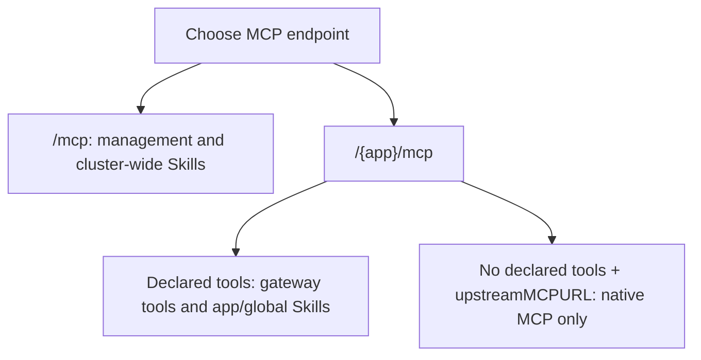

## Context

mcp2rest exposes registered apps through MCP Streamable HTTP. It supports
Liquid-rendered REST tools, individually declared MCP passthrough tools, and
whole native MCP endpoints. These modes do **not** have identical discovery,
authorization, or result semantics. This Skill describes the implemented
runtime, not future policy from the design plan.

## Patterns

### Choose the correct endpoint, then discover

Configure a separate MCP client/server entry for each endpoint you need,
using your provisioned gateway key as `Authorization: Bearer <key>`.
Initialize the MCP connection, then call `tools/list` (following pagination
if returned). Use the exact returned names and input schemas in `tools/call`.



| Endpoint | Tool surface |
|---|---|
| `/mcp` | Management tools and generic Skill tools; **not** app API tools |
| `/{app}/mcp`, with declared `tools` | That app's declared names, tier-filtered, plus app-scoped Skill read tools |
| `/{app}/mcp`, with no declared tools and an `upstreamMCPURL` | The upstream server's own MCP surface, without injected gateway tools or instructions |

If authorized, `list_apps` and `get_manifest` on `/mcp` provide app
registrations and derived connection fields. Prefer `mcpInternalUrl` for
in-cluster clients; `mcpEndpointPath` is the path to combine with an operator-
supplied gateway base URL. These calls do not add a server to your harness or
make app tools callable on `/mcp`. A native registration does not enumerate
upstream tools: discover them on its app endpoint.

### Keys, tiers, and visibility

Gateway keys identify a **namespace-qualified agent instance and tier**,
not an app. There is currently no per-key app allowlist. Registering an app
with `authorizedAgents` ensures agent keys exist; it does not restrict those
keys to that app.

- For **declared tools**, a `user` key can call `user` tools; an `admin` key
  can call both tiers. `tools/list` hides unauthorized declared tools.
  Calling an admin tool directly with a user key is rejected before execution.
- The **same `admin` tier** authorizes all management calls and Skill writes.
  There is no separate proxy-admin scope or per-app-only admin credential.
  Do not assume your agent has an admin key.
- Management and Skill tools are registered even for callers who cannot use
  them. Seeing their names in `tools/list` is **not proof of authorization**.
  Skill reads require a valid user or admin key; all management calls require
  admin, including `list_apps`, `get_manifest`, and `get_key`.
- **Native endpoints** check only for a valid gateway key with a valid tier.
  They do not apply gateway per-tool tier filtering/authorization. The upstream
  server controls its own tools and permissions using its server-owned
  credential, not the gateway caller's tier.

These are gateway guarantees, not proof that an upstream action is permitted
for an end user. Do not use missing per-app restrictions to exceed your task.
The debugging-only `MCP2REST_DISABLE_AUTH=true` switch treats even keyless
requests as admin; it must not be used as a permission workaround.

### Management and durable credential ownership

The management names on `/mcp` are `register_app`, `deregister_app`,
`list_apps`, `get_manifest`, `create_key`, `list_keys`, `get_key`,
`revoke_key`, `rotate_key`, and `reload_cache`. Discover their schemas before
use; none are injected into app sessions.

`register_app` accepts an authorized agent's `tier` (default `user`), but
its current advertised custom schema omits that field. Do not infer the
agent's tier from the app's tool tiers or assume discovery advertises this
optional input.

The gateway persists authoritative agent key material and authorization
metadata in its **own namespace**, restoring the verification index at
startup. The `namespace` on agent-key calls identifies the agent's owner,
not the storage namespace. `register_app` ensures keys but returns only
created-key metadata; `create_key` and `rotate_key` return raw key material,
and admin-only `get_key` can retrieve a persisted key after restart.
`list_keys` never returns raw keys. The provisioner/caller delivers a key to
the harness or an agent-namespace Secret; that copy is not authoritative.
Never put raw keys in logs, examples, or documentation.

Bootstrap uses the persistent gateway Secret `mcp2rest-bootstrap-admin`,
data key `key`; normal startup reuses it, not rotates it or prints its value.
Agent rotation/revocation is manual. Deregistering an app does not revoke
agent keys. Multiple active gateways do not coordinate verification caches.

### Gateway keys are not upstream credentials

Upstream credentials are resolved server-side from gateway-namespace
Secrets: `<app>-api-keys` for rendered REST calls, `<app>-mcp-keys` for MCP
passthrough/native calls. `upstreamCredentialEnv` selects a Secret data key,
not a client argument or a process environment lookup. Declared tools can
override the app-level credential selector and MCP URL.

Rendered templates receive `credential` and choose how to send it. Declared
MCP passthrough uses a fixed Bearer header when a credential is present.
Native proxying strips the client's `Authorization` and `Cookie`, replacing
authorization with the configured server-owned Bearer credential (or sending
none if unconfigured). Never supply an upstream key in place of a gateway key.

Provisioning or rotating upstream Secrets requires an admin `reload_cache`;
Secret changes are not automatically watched. Native endpoints fail closed
with HTTP 503 when a configured credential is unavailable. Legacy declared
tool execution instead receives an empty credential when one is missing,
so an upstream rejection may be the first visible failure.

### Built-in Skill tools

- On `/mcp`: `list_skills`, `get_skill` read Skills cluster-wide for any valid
  key. `create_skill`, `update_skill`, `delete_skill` require admin.
- On declared-tool app routes: only `list_<slug>_skills` and
  `get_<slug>_skill` are injected. The slug lowercases the app name and
  replaces every character outside `[a-z0-9_]` with `_`; e.g.
  `my-app` gets `list_my_app_skills` and `get_my_app_skill`.
- App reads include Skills labeled `skills.homelab.dev/app=<app>` and Skills
  with **no app label**, across namespaces. Another app's Skills are hidden.
  Read `list` summaries, then pass the returned resource `name` and
  `namespace` to `get`; `skillName` is not the resource identifier.
- Native endpoints inject **no** Skill tools. Any similarly named upstream
  tools belong to that server. Use a separate gateway management session if
  you need gateway Skill access.

This bundled file is not automatically loaded by the runtime. Retrieving it
through Skill tools requires it to have been deployed as a visible Skill CR.

### Declared-tool schemas, rendering, and caller identity

Follow the advertised `inputSchema`; the gateway SDK validates declared-tool
arguments before dispatch. An omitted schema becomes an object schema, not
an inferred application contract. A schema without `type` gets `type: object`.

Rendered request templates see `args`, `caller`, and `credential`. A request
template must produce JSON with `method` and `url` or `path`, plus optional
`headers` and `body`; relative targets resolve against `upstreamBaseURL`.
Response templates see only `request` and `response`, not the original
`args`, `caller`, or standalone `credential`. `response.body` is parsed JSON
when possible and otherwise a string; `response.rawBody` is always text.
The rendered output is one MCP text-content item, not structured content.

For declared-tool calls, the optional top-level argument
`__mcp2rest_caller_username` must be a nonblank string. The gateway strips
it from `args` before template/relay execution and exposes it as
`caller.username` to request templates. It is caller-supplied, **not an
authenticated end-user identity**; the schema must permit this argument.
`caller.agentInstance` and `caller.tier` come from the key, and
`caller.appInstance` comes from the route. Templates must explicitly use
caller data for impersonation; no automatic per-user credentials or headers
are supplied. Native bodies are opaque and do not receive this extraction.

Individually declared `type: passthrough` tools still use gateway schemas and
tier checks, map the public name to `upstreamToolName`, and bypass Liquid
execution. They flatten upstream content into one text item (structured
content is JSON-encoded only when no content items exist); upstream
`isError` is **not preserved**. This differs from native endpoint proxying,
which preserves upstream protocol bodies, tool metadata, content, and errors.

### Interpreting pipeline failures

Check both MCP/transport errors and the tool result's `isError` and content.
For declared tools, pipeline errors carry a stage name, but request rendering,
HTTP execution, and response rendering all run inside `upstream-call`;
do not infer the cause solely from the stage label.

| Failure area | What it usually means | Retry guidance |
|---|---|---|
| Gateway authn/authz rejection | Invalid/missing key or insufficient declared-tool/admin tier | Do not retry with the same key |
| Schema or caller-argument validation | Arguments do not match the advertised contract | Correct the input; do not blindly retry |
| Unknown tool/route (including HTTP 404) | Wrong endpoint, registration, or tool name | Check endpoint and refresh discovery |
| Template/JSON-render failure | Manifest or template problem | Report; changing the key will not fix it |
| Rendered upstream HTTP 400+ | Response template still renders; result has `isError: true` | Inspect content; distinguish upstream permission/input errors from transient faults |
| Native HTTP 503 for missing credential | Server-side credential not provisioned/loaded | Ask an operator to provision/reload; do not send your own upstream key |
| Native upstream permission rejection | Server-owned credential or upstream policy rejected the action | Report the upstream error; changing gateway tier is not an upstream permission grant |
| Network/upstream transport failure | Upstream may have executed before the failure | Retry only if safe/idempotent; avoid duplicate side effects |

## Examples

### Management discovery is not app execution

After MCP initialization on `/mcp`, these are JSON-RPC request bodies
(management calls require an admin key):

```json
{"jsonrpc":"2.0","id":1,"method":"tools/list","params":{}}
{"jsonrpc":"2.0","id":2,"method":"tools/call","params":{"name":"list_apps","arguments":{}}}
{"jsonrpc":"2.0","id":3,"method":"tools/call","params":{"name":"get_manifest","arguments":{"appName":"gitea"}}}
```

Only if `gitea` is registered, configure its returned `mcpInternalUrl` as a
separate server with your own agent key. Initialize and list tools there.
If it advertises the repository fixture's `list_my_repos` schema, call:

```json
{"jsonrpc":"2.0","id":4,"method":"tools/call","params":{"name":"list_my_repos","arguments":{"page":1,"limit":20}}}
```

The name is illustrative, not a tool guaranteed on deployed Gitea/native
servers. Do not call it on the management connection.

### Read Skill documentation

On `/mcp`, call `list_skills` with `{}`. Use a returned summary's `name`
and `namespace` in `get_skill`, for example
`{"name":"mcp2rest-usage","namespace":"<namespace-from-list>"}` if present.
On a declared `gitea` route, discover/use `list_gitea_skills` and
`get_gitea_skill` instead. Do not expect these gateway tools on native routes.

## Anti-Patterns

- Guessing app tool names or calling them on `/mcp`
- Treating management tool visibility as authorization
- Assuming gateway keys are app-scoped, or that a native route enforces
  declared-tool tiers or injects gateway Skills
- Treating an agent-supplied username as verified end-user authentication
- Confusing gateway keys, server-owned upstream credentials, and bootstrap keys
- Blindly retrying permission failures or potentially completed writes
